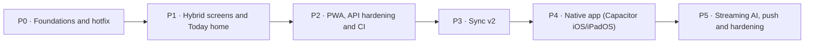

# Forge hybrid build plan

> Generated from `docs/plan/plan.json` by `scripts/plan/plan-lint.mjs --render`. Edit the JSON, not this file.

**Decision:** Hybrid A + B: A responsive shell and domain screens, B bento Today home (decision recorded 2026-11-12).

**6 phases · 46 waves · 154 tasks · widest wave 6 tasks in parallel**

**11 tasks are yours** (marked 👤): `R6-16`, `R6-17`, `R7-03`, `R7-14`, `R7-15`, `P0-U1`, `P1-U1`, `P0-U2`, `P4-U1`, `P5-U1`, `P5-U2`

## Open decisions (defaults are assumed so nothing blocks)

| # | Decision | Default assumed | Affects |
|---|---|---|---|
| D1 | Router: hash URLs (#/life/tasks) or path URLs (/life/tasks)? | Hash. No host rewrite, works unchanged in Capacitor. The router API stays stable so switching later is cheap. | P0 router (R1-04) |
| D2 | Level/XP rule for the Today header: can Level ever go down? | Derived from wallet earnings plus completed tasks; never decreases. | P1 R2-02, ADR B1-05 |
| D3 | Habits and Growth: A-style dense rows or B-style pet tiles? | A rows (R2-13). B tile grid (B3-20) is deferred. | P1 R2-13/R2-14 |
| D4 | Money: 4 sub-views (Overview+Txns merged into Spend) or keep 5? | 4 (merged), as the blueprint shows. | P1 R4-05 |
| D5 | Inspector pane starts at 1024px (your decision) or 1280px (blueprint table)? | 1024px. | P0 R1-06 |
| D6 | Reminders: recurrence (Daily/Monthly) and a notes title field - in scope? | Out of scope for now; the model has neither. | P1 R2-11/R2-12 |
| D7 | Daily code goal and what "solved today" counts? | Goal 3, manual solves only (as today). Real Codeforces submissions can follow. | P1 R3-08 |
| D8 | DSA map: iframe route with ?embed=1, or port to React? | Iframe at #/logic/dsa with a new-tab fallback. | P1 R3-03/R3-04 |
| D9 | Owner-gate /api/cf and /api/quote like /api/agent? | Yes - gate both; apiFetch already sends the token. | P2 R5-04 |
| D10 | Production GROQ_MODEL (code default openai/gpt-oss-120b; README says a retired llama model)? | Keep the code default; fix .env.example and README. | P2 R5-18 |
| D11 | Should Vercel Preview deploys use a separate Supabase project? | Yes, otherwise previews write real data. | P2 R7-14 |
| D12 | PWA icon artwork: approve the generated flame on #0a0c10 or supply your own. | Ship the generated icon first. | P2 R7-03 |
| D13 | Your devices and iOS versions; do you have a Mac with Xcode 26+ and an Apple Developer account; Vercel plan and region. | Unknown - needed before P4. Without a Mac, P4 cannot be built. | P2/P4 |
| D14 | What does "wallet" mean: habit currency, real spend, or both? | Habit currency (earnings from check-ins) in the header; money spend stays in Money. | P1 B3-12/B3-13 |
| D15 | Cream theme synced across devices (in settings) or per-device? | Synced (stored in settings). | P0 R1-09 |
| D16 | Sync v2 cutover: approve running the SQL and backfill on the live Supabase project, and who runs the keep-alive. | Approval required at the time; backup table first; per-key flags and rollback. Keep-alive via Vercel cron. | P3 R6-16/R6-17, P5 X1-08 |
| D17 | Where do Pencil drawings live? | A separate synced collection, never inside notes (IDEAS.md reasoning). | P4 R2-19 |

## P0 · Foundations and hotfix

Fix the live sync write bug, record the decisions, and build the hybrid design system, router, responsive shell, inspector and palette around the unchanged legacy tabs, with test and deploy plumbing.

32 tasks across 8 waves.

**Learn first (blueprint graph):** CSS flex & grid · Fluid & responsive design · Container queries · Design tokens & theming · Pointer, touch & hover · Accessibility · HTTP & REST · Serverless functions

**Exit criteria**
- npm test and npm run build green
- a failed kv_store upload now sets the sync-failed banner (unit test)
- Playwright (Chromium) shows bottom tabs below 600px, a 72px rail at 600-1023px and a 220px sidebar from 1024px, with no horizontal scroll at 390/834/1194/1440
- Cmd/Ctrl+K opens the palette; hover rules are guarded and focus-visible is global (css guard test passes)
- legacy tabs still work inside the new shell
- ADRs 0001-0004 merged

### P0 · Wave 1 — 6 in parallel

| Task | Title | Size | Writes | Depends on | Acceptance |
|---|---|---|---|---|---|
| `B1-01` | Write blueprint errata with the canonical numbers and resolved contradictions | S | `docs/plan/blueprint-errata.md` | — | test -f docs/plan/blueprint-errata.md && grep -c '^\| E-' docs/plan/blueprint-errata.md prints >= 22 (one row per gap in B1-report.md, each with Decision and Owner columns); rail 72px, sidebar 220px, 6 tabs and inspector >=1024 are stated once as canonical |
| `B3-03` | Build UI primitives Tile, Row, Check, Chip, Pill, Stat, EmptyState, Kbd with shared CSS | M | `src/ui/Tile.jsx` `src/ui/Row.jsx` `src/ui/Check.jsx` `src/ui/Chip.jsx` `src/ui/Pill.jsx` `src/ui/Stat.jsx` `src/ui/EmptyState.jsx` `src/ui/Kbd.jsx` `src/ui/ui.css` | — | npm run build exits 0; each component imports only ./ui.css and uses only token names from B3-spec.md section 1 (grep for raw #hex in src/ui/ui.css returns 0 matches); Check hit area is >= 44x44 under pointer:coarse |
| `R1-01` | Scaffold CSS partials and import them from main.jsx | S | `src/main.jsx` `src/styles/tokens.css` `src/styles/shell.css` `src/styles/nav.css` `src/styles/inspector.css` `src/styles/palette.css` `src/styles/overlays.css` `src/styles/screens.css` `src/styles/tiles.css` | — | npm run build succeeds and ls src/styles/*.css \| wc -l prints 8; src/main.jsx imports styles.css first, then the 8 partials in the order tokens, shell, nav, inspector, palette, overlays, screens, tiles. |
| `R1-04` | Add a hash router, route table and useSubView hook with unit tests | M | `src/router.js` `src/routes.js` `test/router.test.js` | — | node --test test/router.test.js passes; tests cover parseHash/formatHash round-trip for #/today, #/life/tasks, #/logic/code, #/money/overview, #/invest/learn, #/agents, unknown paths falling back to #/today, and sub-view ids rejected when not in the table. |
| `R6-01` ⚡ | Make kv_store writes throw on error and retry failed pushes with backoff in sync v1 | S | `src/sync/cloudKv.js` `src/store.js` `src/sync/engine.js` `test/syncCloudKv.test.js` `test/syncEngine.test.js` | — | node --test test/syncCloudKv.test.js test/syncEngine.test.js passes; a fake supabase whose upsert resolves {error} makes cloud.write reject, the key stays pending, the failed flag is set, and a timer-driven retry (1s, 2s, 4s ... capped 5 min) later pushes it |
| `P0-U1` 👤 ⚡ | USER: confirm or override the defaults in docs/plan/OPEN-DECISIONS.md | S | `docs/plan/OPEN-DECISIONS.md` | — | Every decision D1..D17 is marked confirmed or changed in docs/plan/OPEN-DECISIONS.md; changed ones are reflected by re-running plan-synthesize and plan-lint. |

### P0 · Wave 2 — 6 in parallel

| Task | Title | Size | Writes | Depends on | Acceptance |
|---|---|---|---|---|---|
| `B1-03` | Write ADR-0002 delivery path: PWA first, Capacitor second, API base URL and CORS | S | `docs/adr/0002-delivery-path.md` | B1-01 | File defines VITE_API_BASE handling for capacitor://localhost, the CORS allow-list rule, and states the Groq key never ships in a bundle; grep -q 'capacitor://localhost' docs/adr/0002-delivery-path.md |
| `B1-04` | Write ADR-0003 sync v2 design decisions | S | `docs/adr/0003-sync-v2.md` | B1-01 | File decides: rev bump on every write (trigger), per-table cursor, HLC column, tombstone GC rule, treatment of all 17 keys in src/store.js SYNCED_KEYS (table of key -> row shape), per-key flagged migration and rollback; grep -c 'SYNCED_KEYS\\|moodLog\\|settings' docs/adr/0003-sync-v2.md >= 3 |
| `B1-05` | Write ADR-0004 Level/XP derivation for the Today header | S | `docs/adr/0004-level-xp.md` | B1-01 | File states the formula, its inputs (existing earnings/streak data only, no new synced key), 3 worked examples including total 1240 and 0, and the behaviour when check-ins are deleted; formula is marked user-approved |
| `B3-02` | Add hybrid design tokens, cream theme, pastel tile tokens and light-theme status colours | M | `src/styles/tokens.css` `src/styles.css` `src/main.jsx` | R1-01 | npm run build exits 0; with document.documentElement.dataset.accent='cream' the page renders cream and a manual or scripted check confirms every text/background pair in B3-spec.md section 1 is >= 4.5:1; sky and the 5 dark themes are visually unchanged except --text-tertiary and light status colours |
| `B3-04` | Build data-viz primitives Bar, Ring, Donut, Spark with tested geometry helpers | M | `src/ui/Bar.jsx` `src/ui/Ring.jsx` `src/ui/Donut.jsx` `src/ui/Spark.jsx` `src/ui/viz.css` `src/ui/vizMath.js` `test/vizMath.test.js` | — | node --test test/vizMath.test.js passes (donutGradient emits conic-gradient stops summing to 100%, handles empty and single segment, 2px gap option; sparkPoints scales flat series without NaN); npm run build exits 0; Donut renders a text legend and role=img label |
| `R1-05` | Build command registry, command palette dialog and keyboard shortcuts | M | `src/shell/CommandPalette.jsx` `src/shell/commands.js` `src/shell/useShortcuts.js` `src/styles/palette.css` `test/commands.test.js` `src/shell/searchIndex.js` `test/searchIndex.test.js` | R1-01, R1-04 | node --test test/commands.test.js passes (registry register/unregister, fuzzy filter ranking, shortcut matcher for Cmd+K, Ctrl+K, Cmd+1..6, N, X, and ignoring keys typed in input/textarea/select); npm run build passes. |

### P0 · Wave 3 — 6 in parallel

| Task | Title | Size | Writes | Depends on | Acceptance |
|---|---|---|---|---|---|
| `B1-02` | Write ADR-0001 hybrid shell and Today home | S | `docs/adr/0001-hybrid-shell-and-today.md` | B1-01 | File has Context, Decision, Consequences, Alternatives (A, B, C rejected parts) sections; states container-query root, breakpoints 600/1024, routes, inspector from 1024, Today tab id (not 'Today'), and the fixed-position containing-block rule; grep -c '^## ' prints >= 4 |
| `B1-08` | Add learning-track generator, validation test and rendered track doc | M | `docs/learning/concept-phase-map.json` `docs/learning/learning-track.md` `scripts/plan/learning-track.mjs` `test/learningTrack.test.js` | — | node scripts/plan/learning-track.mjs exits 0 and writes docs/learning/learning-track.md (55 concepts, per-phase prerequisite table); node --test test/learningTrack.test.js passes: 55 unique ids, all requires resolve, no cycle, no prerequisite in a later phase |
| `R1-06` | Build container-query shell with bottom tabs, 72px rail and 220px sidebar | M | `src/shell/Shell.jsx` `src/shell/Nav.jsx` `src/shell/TopBar.jsx` `src/styles/shell.css` `src/styles/nav.css` | R1-01, B3-02, R1-04, B3-03 | npm run build passes; with the dev server, at widths 390, 700, 1100 and 1400 the nav is respectively bottom tabs, 72px rail, 220px sidebar, sidebar; 6 tabs fit at 375px without horizontal scroll; the nav has aria-label and aria-current="page" on the active item; Tab key shows a visible focus ring on every nav item. |
| `R1-07` | Make Sheet, Toast and FAB placement responsive via tokens | S | `src/styles/overlays.css` | R1-01, B3-02 | npm run build passes; overlays.css has no 100vw and no literal 64px/80px bottom offsets; at <600 sheet is a bottom sheet with safe-area padding and max-height in dvh, at 600-1023 a centred modal max 520px, at >=1024 a right-side sheet; toast and FAB bottom offsets equal calc(var(--tabbar-h) + env(safe-area-inset-bottom) + 12px) with --tabbar-h 0 when rail or sidebar is active; FAB hidden at >=1024. |
| `R5-14` | Add vercel.json with SPA rewrite, function config and /api/puzzle cache header | S | `vercel.json` `test/vercelConfig.test.js` | — | node --test test/vercelConfig.test.js passes: JSON parses; rewrite sends non-api, non-asset, non-/dsa paths to /index.html and leaves /api/*, /dsa/*, /manifest.json and /puzzles.json untouched; functions config sets maxDuration; /api/puzzle has Cache-Control public, s-maxage>=3600, stale-while-revalidate. |
| `R7-01` | Add all infra devDependencies and npm scripts in one commit (single writer of package.json and lockfile) | S | `package.json` `package-lock.json` | — | npm ci && npm test && npm run build all pass; npm ls vite-plugin-pwa workbox-window @playwright/test eslint eslint-plugin-react-hooks @vite-pwa/assets-generator lists the pinned versions; npx playwright --version prints 1.63.0; scripts lint, test:e2e, build:e2e, preview:e2e, icons, size exist in package.json. |

### P0 · Wave 4 — 6 in parallel

| Task | Title | Size | Writes | Depends on | Acceptance |
|---|---|---|---|---|---|
| `B1-06` | Create the ADR index | S | `docs/adr/README.md` | B1-02, B1-03, B1-04, B1-05 | docs/adr/README.md lists each ADR file with status and date; node -e "const fs=require('fs');const t=fs.readFileSync('docs/adr/README.md','utf8');process.exit(fs.readdirSync('docs/adr').filter(f=>/^\d{4}-/.test(f)).every(f=>t.includes(f))?0:1)" exits 0 |
| `R1-02` | Guard hover rules with (hover: hover) and add a global focus-visible ring | S | `src/styles.css` `src/Toast.jsx` | — | node -e "const s=require('fs').readFileSync('src/styles.css','utf8');const o=s.replace(/@media \(hover: hover\)[^{]*\{(?:[^{}]*\{[^{}]*\})*[^{}]*\}/g,'');process.exit(/:hover/.test(o)?1:0)" exits 0 (it exits 1 today with 18 matches); styles.css contains a :focus-visible rule using var(--focus-ring, ...); npm run build passes. |
| `R1-08` | Add inspector pane primitive that falls back to a Sheet below 1024px | S | `src/shell/Inspector.jsx` `src/shell/inspectorContext.js` `src/styles/inspector.css` `src/Sheet.jsx` | R1-06 | npm run build passes; useInspector().open(node) renders the node in a right-hand pane when the container is wider than --inspector-min and in <Sheet> otherwise; Escape or close() empties it; pane scrolls independently and has a labelled region role. |
| `R5-01` | Add apiUrl/apiFetch helper with VITE_API_BASE and Bearer injection | S | `src/api/base.js` `src/api/client.js` `test/apiBase.test.js` | — | node --test test/apiBase.test.js passes: apiUrl('/api/x') returns '/api/x' when base is empty and 'https://h/api/x' when base is 'https://h/' (no double slash); apiFetch attaches Authorization only when a token exists. |
| `R7-07` | Add Playwright config with the 5 blueprint device projects plus a pwa project, hermetic Supabase fixtures and a smoke spec | M | `playwright.config.js` `.env.e2e` `e2e/fixtures/hermetic.js` `e2e/fixtures/data.js` `e2e/smoke.spec.js` `.gitignore` | R7-01 | npm run test:e2e passes on projects iphone-14, ipad-portrait, ipad-landscape, ipad-split-third and desktop-chrome using the preinstalled Chromium; smoke.spec.js asserts the app boots signed in with seeded kv_store rows, the tab bar renders, no pageerror, and zero unfulfilled non-localhost requests; viewports are 390x844, 834x1194, 1194x834, 375x1024 and 1440x900. |
| `P0-U2` 👤 | USER: connect the repo to Vercel so every push gets a preview URL, and set the environment variables | S | `docs/runbooks/vercel-preview-setup.md` | R5-14 | A pushed branch shows a Vercel preview URL that loads the app and signs in; VITE_SUPABASE_URL, VITE_SUPABASE_ANON_KEY, GROQ_API_KEY and OWNER_USER_ID are set for Preview and Production; the log records whether Preview uses a separate Supabase project (decision D11). Needed before the P1 real-device check. |

### P0 · Wave 5 — 5 in parallel

| Task | Title | Size | Writes | Depends on | Acceptance |
|---|---|---|---|---|---|
| `B3-05` | Add standalone UI gallery page for viewing primitives at phone, tablet and desktop widths | S | `gallery.html` `src/ui/gallery-main.jsx` `src/ui/Gallery.jsx` | B3-02, B3-03, B3-04 | npm run dev then open /gallery.html: all primitives render in all 7 themes (theme switcher on the page) with no console errors; npm run build still exits 0 (gallery.html is not a build input) |
| `B3-16` | Build SubNav component (route-driven sub-view pills) | S | `src/ui/SubNav.jsx` `src/ui/subnav.css` | B3-03, R1-04 | npm run build exits 0; SubNav renders links with aria-current, horizontal scroll without a visible scrollbar, active pill scrolled into view, items >= 44px tall under pointer:coarse; visually matches today's .agent-bar/.agent-pill in ocean theme |
| `R1-09` | Wire shell and routes into App.jsx with Home as first and default tab | M | `src/App.jsx` `src/tabs/Home.jsx` | R1-04, R1-05, R1-06, R1-08 | npm run build passes; opening / redirects to #/today and shows the Home stub; #/life/tasks, #/logic/code, #/money/overview, #/invest/learn and #/agents open the matching tab; TABS lists Home, Life, Logic, Money, Invest, Agents in that order; KEY_TO_TAB accepts arrays so a remote 'tasks' change bumps both Life and Home ticks; THEMES includes cream; document theme-color meta is updated on theme change. |
| `R1-11` | Add wide-pane CSS for legacy single-column blocks | S | `src/styles/screens.css` | R1-06 | npm run build passes; at container width >=600 the .page content has a max-width token, .stat-row/.life-stats keep equal columns, .expense-cat-grid goes to 6 columns, .chat-bubble max-width is 70ch; no change below 600px (390px screenshot identical). |
| `R5-13` | Extract dev API plugin to vite-plugins/apiDev.js with body cap and 400 on bad JSON | S | `vite.config.js` `vite-plugins/apiDev.js` `test/apiDev.test.js` | — | node --test test/apiDev.test.js passes: malformed JSON body returns 400, body over 1 MB returns 413, OPTIONS reaches the handler; curl localhost:5173/api/health still returns {"ok":true} under npm run dev and npm run preview. |

### P0 · Wave 6 — 1 in parallel

| Task | Title | Size | Writes | Depends on | Acceptance |
|---|---|---|---|---|---|
| `R1-10` | Migrate legacy styles.css to tokens and remove the old tab bar and 640px shell | M | `src/styles.css` | R1-02, R1-07, R1-09 | npm run build passes; styles.css no longer contains .tab-bar, .tab-bar-inner, .tab-btn, the sticky .app-header rule, .content padding-bottom:100px, or the legacy .toast-stack/.expense-fab/.sheet-dialog positioning; .app keeps only the auth-screen centring (max-width allowed there); .puzzle-card, the title gradient, send-btn hover and fab hover shadow use theme tokens so they render correctly under data-accent sky and cream. |

### P0 · Wave 7 — 1 in parallel

| Task | Title | Size | Writes | Depends on | Acceptance |
|---|---|---|---|---|---|
| `R1-13` | Add static CSS guard test for shell and input-model rules | S | `test/shellCss.test.js` | R1-10 | node --test test/shellCss.test.js passes and fails if any of these regress: a :hover rule outside @media (hover: hover) in any src CSS file, a 100vw or calc(64px + ...) literal, a missing @container app (min-width:600px) or (min-width:1024px) block, a missing :focus-visible rule, or a missing data-accent="cream" block. |

### P0 · Wave 8 — 1 in parallel

| Task | Title | Size | Writes | Depends on | Acceptance |
|---|---|---|---|---|---|
| `P0-GATE` | P0 gate: verify exit criteria and record the result | S | `docs/plan/gates/P0.md` | B1-01, B1-02, B1-03, B1-04, B1-05, B1-06, B1-08, B3-02, B3-03, B3-04, B3-05, B3-16, R1-01, R1-02, R1-04, R1-05, R1-06, R1-07, R1-08, R1-09, R1-10, R1-11, R1-13, R5-01, R5-13, R5-14, R6-01, R7-01, R7-07, P0-U1, P0-U2 | npm test and npm run build green \| a failed kv_store upload now sets the sync-failed banner (unit test) \| Playwright (Chromium) shows bottom tabs below 600px, a 72px rail at 600-1023px and a 220px sidebar from 1024px, with no horizontal scroll at 390/834/1194/1440 \| Cmd/Ctrl+K opens the palette; hover rules are guarded and focus-visible is global (css guard test passes) \| legacy tabs still work inside the new shell \| ADRs 0001-0004 merged |

## P1 · Hybrid screens and Today home

Rebuild every screen on the new shell: bento Today home plus the Life, Logic, Money, Invest and Agents tabs as list/inspector screens, each with a single writer per data key.

51 tasks across 10 waves.

**Learn first (blueprint graph):** React components & hooks · State & derived state · Animation & reduced motion · Gestures & drag-drop · Code splitting · Testing pyramid

**Exit criteria**
- all 17 sub-views reachable at #/<tab>/ and rendering in tab, rail and sidebar modes
- Today grid shows 2, 4 and 6 columns by grid width
- legacy Life, Expenses, Invest and Today implementations replaced; no two components save the same whole array (provider tests)
- device-matrix Playwright specs pass
- user completed the real iPhone/iPad device checklist (P1-U1)

### P1 · Wave 1 — 6 in parallel

| Task | Title | Size | Writes | Depends on | Acceptance |
|---|---|---|---|---|---|
| `R2-02` | Derive Level/XP from existing earnings and completed tasks | S | `src/life/progress.js` `test/lifeProgress.test.js` | — | node --test test/lifeProgress.test.js passes; xpFor(habits,tasks,now)=sum(earnings.total)+10*doneTasks, levelFromXp(xp) with level n starting at 30*(n-1)^2 returns {level,into,needed,pct}; level never decreases when passed a highWater >= xp |
| `R2-05` | Split Life.jsx into per-screen component files with no behaviour change | M | `src/tabs/Life.jsx` `src/life/screens/Tasks.jsx` `src/life/screens/Reminders.jsx` `src/life/screens/Habits.jsx` `src/life/screens/Growth.jsx` `src/life/confetti.js` | — | Life.jsx drops below 200 lines; TasksView/TaskSection/DoneTaskSection (236-618), RemindersView (620-752), HabitsView (754-983), GrowthView (985-1078) live one per screen file as default exports with unchanged props; npm run build succeeds; manual check: all 5 Life sub-views render and add/toggle/drag a task as before |
| `R3-01` | Add pure Logic helpers (stats, exam data, split hook, shared CSS) with unit tests | S | `src/logic/stats.js` `src/logic/examData.js` `src/logic/useSplit.js` `src/logic/logic.css` `test/logicStats.test.js` | — | node --test test/logicStats.test.js passes: solvedToday (same result as Today.jsx:24 for local midnight), codeRing(progress, goal=3), codeStreak from dated progress, localDaySeed, shuffleDaily determinism, examTotals ignores unknown keys and never exceeds 100%; examData.js exports EXAMS identical to Exams.jsx:8-89 (66 topics) |
| `R3-04` | Add ?embed=1 mode, summary export, pre-pull backup and account-owner guard to the mastery map page | M | `public/dsa/mastery-map.html` `test/dsaPage.test.js` | — | node --test test/dsaPage.test.js passes: pins STORAGE keys (mastery_map_v2, mastery_map_problems, mastery_tab, roadmap_phase, roadmap_rating), DATA_KEY dsa_mastery_v1 and the ours() regex, and checks the embed hooks exist; manual: /dsa/mastery-map.html?embed=1 at 390px has no horizontal scroll and no '← Forge' link, 1024-1119px width is usable, after edits localStorage.dsa_summary = {done,total,tabs,at} and that key is NOT pushed (does not match ours()); signing in as a different user clears mastery_*/roadmap_* before pulling; a pull that changes local data first saves dsa_pre_pull_backup |
| `R4-01` | Extract Money pure helpers (month summary, category breakdown, trend, budget status, formatters) with unit tests | M | `src/money/logic.js` `src/money/categories.js` `src/money/format.js` `test/moneyLogic.test.js` `test/moneyFormat.test.js` | — | node --test test/loanBalance.test.js test/moneyLogic.test.js test/moneyFormat.test.js passes; tests cover legacy entries with no type counted as expense, income excluded from spend, local-midnight month boundary, 3-month trend, daysLeftInMonth, spent-vs-totalBudget pct |
| `R4-12` | Extract Invest pure helpers (course progress, unlock rules, watchlist sort/filter/movers) with unit tests | S | `src/invest/progress.js` `src/invest/watchlist.js` `test/investLogic.test.js` | — | node --test test/investLogic.test.js passes; covers isUnlocked chain (m1 always open), courseProgress pct for 0/19 and 19/19, sortWatchlist (IPOs first by open date, then addedAt desc), summarizeMovers counts up/down/unavailable |

### P1 · Wave 2 — 6 in parallel

| Task | Title | Size | Writes | Depends on | Acceptance |
|---|---|---|---|---|---|
| `R2-01` | Extract pure task/reminder/streak selectors with unit tests | S | `src/life/selectors.js` `test/lifeSelectors.test.js` | — | node --test test/lifeSelectors.test.js passes; exports taskBuckets(tasks,todayKey), matchesUrgency, quadrantOf, quadrantCounts, dueCounts(tasks,reminders,now), walletTotal(habits,now), overallStreak(habits,now) with the same results as Life.jsx:57-70, 160-165, 340-346 |
| `R2-08` | Add MasterDetail layout primitive and life.css for list plus inspector panes | S | `src/life/ui/MasterDetail.jsx` `src/life/life.css` | R1-08, B3-03 | MasterDetail({list,detail,inspector,hasSelection,onBack}) renders list only below 600px with detail as a Sheet, list+inspector from 1024px and list+detail+inspector from 1280px via @container app rules; no rule touches src/styles.css; npm run build succeeds |
| `R2-09` | Make dnd safe for multi-pane layouts: DragOverlay, coarse-pointer handle, multi-id move | M | `src/dnd/Dnd.jsx` `src/dnd/dnd.css` `src/dnd/logic.js` `test/dndLogic.test.js` | — | node --test test/dndLogic.test.js passes with new tests for moveMany(list,ids,overId,{patch,after}); DndArea accepts optional renderOverlay and TouchSensor long-press (250ms) props with unchanged defaults; .drag-handle min-size 44px under (pointer: coarse) via dnd.css; Expenses.jsx still drags with no edit |
| `R3-08` | Add the Logic tile-data selector for the Today home (code ring, streak, puzzles, exams, DSA, cached rating) | S | `src/logic/tileData.js` `test/logicTileData.test.js` | R3-01, R3-04 | node --test test/logicTileData.test.js passes with injected getters and a fake storage: loadLogicTileData() returns {codeRing:{done,goal,pct}, codeStreak, cfRating\|null, puzzles:{solved,total}, exams:{pct}, dsa:{done,total}\|null}; dsa is null when dsa_summary is missing or corrupt; rememberCfRating(rating, storage) round-trips and never throws when storage is blocked |
| `R4-03` | Create MoneyContext: one shared hydrate/persist layer for expenses, budgets, goals, loans plus month state and add-sheet requests | S | `src/money/MoneyContext.jsx` | R4-01 | npx --no-install esbuild src/money/MoneyContext.jsx --bundle --format=esm --jsx=automatic --loader:.css=empty --external:react --external:react/jsx-runtime --external:localforage --external:@supabase/supabase-js --external:@dnd-kit/* --log-level=error --outfile=/dev/null exits 0; exports MoneyProvider and useMoney() returning {expenses,budgets,goals,loans,viewMonth,prevMonth,nextMonth,persist*,openAdd,openEdit,sheetRequest,saving,ready,error} |
| `R4-13` | Extend quote API: return daily closes for sparklines, fix changePct for multi-day ranges, allow whitelisted range and index symbols | S | `api/quote.js` `api/_lib/parseYahooChart.js` `test/parseYahooChart.test.js` | — | node --test test/parseYahooChart.test.js passes with new cases (closes array drops nulls, changePct uses last two closes when range>1d, old fixtures unchanged); GET /api/quote?symbols=TCS.NS&range=1mo returns closes (needs network); range outside 1d\|5d\|1mo\|3mo returns 400; SYMBOL_RE allowlist still rejects anything but .NS/.BO or the named index list |

### P1 · Wave 3 — 6 in parallel

| Task | Title | Size | Writes | Depends on | Acceptance |
|---|---|---|---|---|---|
| `R2-04` | Add mutate wrappers for tasks, habits, moodLog and notes to store.js | S | `src/store.js` | — | grep -n "export async function mutate" src/store.js lists mutateReminders, mutateTasks, mutateHabits, mutateMoodLog, mutateNotes, each delegating to engine.mutate(key, fn, []); npm test still passes |
| `R2-06` | Move Notes.jsx under src/life/screens and extract tree helpers with tests | S | `src/tabs/Notes.jsx` `src/life/screens/Notes.jsx` `src/life/notesTree.js` `test/notesTree.test.js` `src/tabs/Life.jsx` | R2-05 | node --test test/notesTree.test.js passes (buildChildMap, sortSiblings pinned-first, collectDescendantIds, descendant count); src/tabs/Notes.jsx no longer exists; grep -rn "tabs/Notes" src returns nothing; notes still nest, pin and cascade-delete with undo |
| `R2-10` | Build Tasks list with right-hand task inspector (subtasks, flags, due) | M | `src/life/screens/Tasks.jsx` `src/life/screens/TaskInspector.jsx` | R2-01, R2-05, R2-08, R2-09 | At 1280x800 selecting a task row opens its inspector with title/due edit, urgent/important toggles and the subtask list (moved out of the inline expander at old Life.jsx:532-572); at 390px the same editor opens as a Sheet; X on a selected row completes it; dragging a task between sections still patches due via taskDropPatch |
| `R2-15` | Add pure lifeTileData function that feeds Today tiles from Life data | S | `src/life/todayTiles.js` `test/lifeTodayTiles.test.js` | R2-01, R2-02 | node --test test/lifeTodayTiles.test.js passes; lifeTileData(tasks,reminders,habits,moodLog,now) returns {streak:{current,best},wallet:{total,today},pets:[{id,species,stage,mood,health}],tasks:{overdue,today,next},reminders:{due,next},mood:{today,avg,trend},level:{level,pct}} for empty and populated inputs |
| `R4-04` | Build AddTxnSheet (add/edit income or expense) driven by MoneyContext sheetRequest | S | `src/money/AddTxnSheet.jsx` | R4-03 | npx --no-install esbuild src/money/AddTxnSheet.jsx --bundle --format=esm --jsx=automatic --loader:.css=empty --external:react --external:react/jsx-runtime --external:localforage --external:@supabase/supabase-js --external:@dnd-kit/* --log-level=error --outfile=/dev/null exits 0; behaviour: edit keeps id and original time-of-day, amount > 10_000_000 or <= 0 blocked, expense requires category (same rules as Expenses.jsx:216-250) |
| `R4-14` | Create market data client with TTL cache and in-flight dedupe (quotes, MF search, MF NAV) plus useQuotes hook | M | `src/invest/market.js` `src/invest/useQuotes.js` `test/marketCache.test.js` | R4-13, R5-01 | node --test test/marketCache.test.js passes using an injected fetch: two concurrent calls hit fetch once, entries expire after 60s, a failed symbol yields {error:true} without failing others; npx --no-install esbuild src/invest/useQuotes.js --bundle --format=esm --jsx=automatic --loader:.css=empty --external:react --external:react/jsx-runtime --external:localforage --external:@supabase/supabase-js --external:@dnd-kit/* --log-level=error --outfile=/dev/null exits 0 |

### P1 · Wave 4 — 6 in parallel

| Task | Title | Size | Writes | Depends on | Acceptance |
|---|---|---|---|---|---|
| `B3-11` | Build Today tiles: Streak, Wallet, Pets, Code ring, Tasks | M | `src/today/tiles/StreakTile.jsx` `src/today/tiles/WalletTile.jsx` `src/today/tiles/PetsTile.jsx` `src/today/tiles/CodeTile.jsx` `src/today/tiles/TasksTile.jsx` `src/today/tiles/tiles-a.css` | R2-15, B3-02, B3-03, B3-04, R2-02, R3-08 | npm run build exits 0; each tile is a pure presentational component taking data via props (no store imports) and renders loading, empty and populated states in /gallery.html; task complete and check-in controls are >= 44px and call onToggleTask/onCheckIn props |
| `B3-12` | Build Today tiles: Spend donut, Mood, Watch, Tutor prompt | M | `src/today/tiles/SpendTile.jsx` `src/today/tiles/MoodTile.jsx` `src/today/tiles/WatchTile.jsx` `src/today/tiles/TutorTile.jsx` `src/today/tiles/tiles-b.css` | R2-15, B3-02, B3-03, B3-04, R4-01, R4-12, R4-14, R3-08 | npm run build exits 0; Mood tile shows 5 buttons (MANUAL_MOODS) each >= 44px and spans full width at 2 columns; Spend tile hides the '% of budget' line when total budget is 0; Watch tile renders an offline fallback from priceAtAdd when the quote prop is null; all four verified in /gallery.html |
| `R2-11` | Build Reminders list with inspector and the missing edit-title/time action | M | `src/life/screens/Reminders.jsx` `src/life/screens/ReminderInspector.jsx` | R2-05, R2-08, R5-01 | Selecting a reminder at >=1024px opens an inspector where title and datetime-local can be edited and saved (re-sorted by at); Add to Calendar link still returns a valid .ics (node --test test/ics.test.js passes); phone uses a Sheet |
| `R2-12` | Build Notes editor pane with tree list and tag/colour/pin inspector | M | `src/life/screens/Notes.jsx` `src/life/screens/NoteInspector.jsx` | R2-06, R2-08 | At >=1280px the tree list, a body editor and an inspector (tags, colour, pin, parent, created) are visible together; at 390px a tapped note opens the editor full-screen with a back control; nest/unnest by drag still blocks cycles (canNest); cascade delete shows the confirm and undo toast |
| `R2-13` | Build Habits dense rows with pet inspector and last-30-days calendar helper | M | `src/life/screens/Habits.jsx` `src/life/screens/HabitInspector.jsx` `src/life/habitView.js` `test/lifeHabitView.test.js` | R2-05, R2-08, R2-09 | node --test test/lifeHabitView.test.js passes for lastNDays(checkins,now,30) -> [{date,checked}] across a DST change and month ends; at >=1024px a habit row opens an inspector with pet, health bar, traits, earnings and the 30-day grid; check-in, edit, remove-with-undo and reorder still work; phone keeps cards |
| `R4-15` | Create InvestContext: shared hydrate/persist for investProgress and watchlist | S | `src/invest/InvestContext.jsx` | R4-12 | npx --no-install esbuild src/invest/InvestContext.jsx --bundle --format=esm --jsx=automatic --loader:.css=empty --external:react --external:react/jsx-runtime --external:localforage --external:@supabase/supabase-js --external:@dnd-kit/* --log-level=error --outfile=/dev/null exits 0; useInvest() exposes {progress,watchlist,updateProgress,updateWatchlist,ready,error} and keeps the {done,quiz,tasks,current} shape |

### P1 · Wave 5 — 6 in parallel

| Task | Title | Size | Writes | Depends on | Acceptance |
|---|---|---|---|---|---|
| `R2-07` | Create LifeData provider as single writer with silent refresh, badge and mood derivation | M | `src/life/LifeData.jsx` `src/tabs/Life.jsx` | R2-01, R2-04, R2-05 | useLife() returns {tasks,reminders,habits,moodLog,now,ready,updateTasks(fn),...} backed by mutate* wrappers; remote syncTick refreshes arrays without flipping ready=false (an open edit draft survives); ensureTodayEntry and checklist migration run once in the provider; setAppBadge effect lives in the provider; Life.jsx consumes useLife and passes props to screens; manual two-mount check (provider + a second consumer completing a task) leaves both lists consistent after reload |
| `R2-14` | Build Growth block layout with per-domain inspector and domainBreakdown helper | M | `src/life/screens/Growth.jsx` `src/life/screens/GrowthInspector.jsx` `src/life/growth.js` `test/lifeGrowth.test.js` | R2-05, R2-08 | node --test test/lifeGrowth.test.js passes: domainBreakdown(habits,domain) lists contributing habits whose points sum to computeStats(habits)[domain] before the 100 cap; at >=1024px clicking a domain bar opens its breakdown and titles; mood picker and 30-day strip unchanged; node --test test/growth.test.js still passes |
| `R4-05` | Build SpendScreen merging Overview + Txns: month stats, category bars, 3-month trend, grouped transaction list, search/type filter | M | `src/money/screens/SpendScreen.jsx` `src/money/screens/SpendSummary.jsx` `src/money/screens/TxnList.jsx` `src/money/screens/spend.css` | R4-01, B3-04, R4-03, R4-04 | npx --no-install esbuild src/money/screens/SpendScreen.jsx --bundle --format=esm --jsx=automatic --loader:.css=empty --external:react --external:react/jsx-runtime --external:localforage --external:@supabase/supabase-js --external:@dnd-kit/* --log-level=error --outfile=/dev/null exits 0; at 390px stats are 2 columns, at >=1024px summary and txn list sit side by side; row tap calls openEdit; delete shows undo toast |
| `R4-08` | Build LoansScreen with LoanPersonCard and LoanFormSheet (incl. follow-up reminder via mutateReminders) | M | `src/money/screens/LoansScreen.jsx` `src/money/screens/LoanPersonCard.jsx` `src/money/screens/LoanFormSheet.jsx` | R4-01, R4-03 | npx --no-install esbuild src/money/screens/LoansScreen.jsx --bundle --format=esm --jsx=automatic --loader:.css=empty --external:react --external:react/jsx-runtime --external:localforage --external:@supabase/supabase-js --external:@dnd-kit/* --log-level=error --outfile=/dev/null exits 0; balances come only from computeLoanBalances; remind-me writes {id,title,at,done,createdAt} through mutateReminders; node --test test/loanBalance.test.js still passes |
| `R4-16` | Build LearnScreen (module list, ModuleView, Quiz, glossary, resources) with two-pane layout from 1024px | M | `src/invest/screens/LearnScreen.jsx` `src/invest/screens/ModuleView.jsx` `src/invest/screens/Quiz.jsx` `src/invest/screens/ResourcesCard.jsx` `src/invest/screens/learn.css` | R4-12, R4-15 | npx --no-install esbuild src/invest/screens/LearnScreen.jsx --bundle --format=esm --jsx=automatic --loader:.css=empty --external:react --external:react/jsx-runtime --external:localforage --external:@supabase/supabase-js --external:@dnd-kit/* --log-level=error --outfile=/dev/null exits 0; pass threshold stays 80, locked modules disabled, CONTENT still rendered only from course.js strings |
| `R4-18` | Build WatchScreen (WatchRow with sparkline, AddStock/AddMf/AddIpo forms, note edit, delete with undo) | M | `src/invest/screens/WatchScreen.jsx` `src/invest/screens/WatchRow.jsx` `src/invest/screens/AddForms.jsx` `src/invest/screens/watch.css` | B3-04, R4-12, R4-14, R4-15 | npx --no-install esbuild src/invest/screens/WatchScreen.jsx --bundle --format=esm --jsx=automatic --loader:.css=empty --external:react --external:react/jsx-runtime --external:localforage --external:@supabase/supabase-js --external:@dnd-kit/* --log-level=error --outfile=/dev/null exits 0; editing a note does not trigger a network refetch; item shape {id,type,symbol\|schemeCode,name,priceAtAdd,note,addedAt,ipo} unchanged; prop initialType opens the matching add form |

### P1 · Wave 6 — 6 in parallel

| Task | Title | Size | Writes | Depends on | Acceptance |
|---|---|---|---|---|---|
| `B3-10` | Emit local key-change events from the store and add useStoreKey hook | S | `src/storeEvents.js` `src/useStoreKey.js` `src/store.js` `test/storeEvents.test.js` | — | node --test test/storeEvents.test.js passes (subscribe/emit/unsubscribe, emit after save, no listener leak); in the dev app saving habits from Life updates a component using useStoreKey('habits') without a remount; existing node --test suite still green |
| `B3-18` | Retrofit the Agents screen for the hybrid shell: wide chat plus agent-list pane, sub-view routing | S | `src/tabs/Agents.jsx` | R1-09, B3-16 | npm test && npm run build green; /logic/code\|puzzles\|exams\|dsa, /invest/learn\|research\|watch and /agents load directly; /agents?q=hello opens with the input prefilled and not auto-sent; the DSA route renders a block linking to /dsa/mastery-map.html (iframe embed deferred); Agents module-scope chat state still survives navigation |
| `R3-03` | Create DsaView, a same-origin iframe wrapper for the DSA mastery map with loading and failure fallback | S | `src/tabs/DsaView.jsx` `src/logic/dsa.css` | — | npm run build passes; rendering <DsaView/> shows an iframe with src /dsa/mastery-map.html?embed=1, title attribute, fills the available height (no page-level double scroll at 390 and 1194 widths), shows a skeleton until onLoad and, after 8s without load, a visible 'Open in new tab' link (target=_blank rel=noopener) |
| `R4-06` | Build BudgetsScreen: per-category monthly limits with inline edit and over-80% warnings | S | `src/money/screens/BudgetsScreen.jsx` | R4-01, R4-03 | npx --no-install esbuild src/money/screens/BudgetsScreen.jsx --bundle --format=esm --jsx=automatic --loader:.css=empty --external:react --external:react/jsx-runtime --external:localforage --external:@supabase/supabase-js --external:@dnd-kit/* --log-level=error --outfile=/dev/null exits 0; set/remove budget persists to key budgets as a plain {catId:number} map; bar colour thresholds 80/100 match Expenses.jsx:850-851 |
| `R4-07` | Build GoalsScreen with GoalFormSheet: create, add funds, delete with undo, drag reorder | S | `src/money/screens/GoalsScreen.jsx` `src/money/screens/GoalFormSheet.jsx` | R4-01, R4-03 | npx --no-install esbuild src/money/screens/GoalsScreen.jsx --bundle --format=esm --jsx=automatic --loader:.css=empty --external:react --external:react/jsx-runtime --external:localforage --external:@supabase/supabase-js --external:@dnd-kit/* --log-level=error --outfile=/dev/null exits 0; reorder still goes through placeItem and persists array order; saved never goes below 0 |
| `R4-17` | Build ResearchScreen (static screening checklists, OSS tools, links) with onTrack(type) callback | S | `src/invest/screens/ResearchScreen.jsx` | — | npx --no-install esbuild src/invest/screens/ResearchScreen.jsx --bundle --format=esm --jsx=automatic --loader:.css=empty --external:react --external:react/jsx-runtime --external:localforage --external:@supabase/supabase-js --external:@dnd-kit/* --log-level=error --outfile=/dev/null exits 0; prop onTrack("stock"\|"mf"\|"ipo") replaces onGoToWatch; no store access |

### P1 · Wave 7 — 6 in parallel

| Task | Title | Size | Writes | Depends on | Acceptance |
|---|---|---|---|---|---|
| `B3-13` | Assemble Today home: bento grid, data hook, shared progress-summary hook for header pills | M | `src/today/TodayHome.jsx` `src/today/useTodayData.js` `src/today/useProgressSummary.js` `src/today/today.css` `src/tabs/Home.jsx` | B3-10, B3-11, B3-12 | npm run build exits 0; with the dev app: grid is 2 columns at 390px, 4 at 834px, 6 at 1194px (grid is its own container with thresholds 600/900); DOM order is streak, wallet, pets, code, watch, tasks, spend, mood, tutor; today mood entry is derived via ensureTodayEntry only after all keys are ready (no overwrite of existing moodLog); checking a task on the tile updates the 'tasks' key and the header Lv/wallet pills refresh without reload |
| `R2-17` | Export Life view registry and accept view/onViewChange props for router and palette | S | `src/life/views.js` `src/tabs/Life.jsx` | R2-07, R2-10, R2-11, R2-12, R2-13, R2-14, B3-16, R1-04 | views.js exports LIFE_VIEWS [{id:'tasks',path:'/life/tasks',label,icon,group,shortcut}] for the 5 views; Life({view,onViewChange}) renders the requested screen and the internal two-row pill bar is hidden when onViewChange is supplied; the palette can list the 5 entries from LIFE_VIEWS |
| `R3-02` | Rename Today.jsx to CodeView.jsx and turn LogicBuilding into a controlled four-view host (code, puzzles, exams, dsa) | M | `src/tabs/LogicBuilding.jsx` `src/tabs/Today.jsx` `src/tabs/CodeView.jsx` `src/tabs/Exams.jsx` | R3-01, R3-03, R1-04, B3-16 | npm test && npm run build pass; grep -rn "tabs/Today" src returns nothing; LogicBuilding accepts view/onViewChange props (falls back to local state when absent) and renders Code, Puzzles, Exams and a lazy DsaView; the old top DSA link is gone; glance numbers equal the previous ones; ticks read as (syncTicks.Code\|\|0)+(syncTicks.Today\|\|0) |
| `R3-11` | Add a client fetchJson helper that turns network, HTTP and parse failures into friendly typed errors | S | `src/logic/apiClient.js` `test/logicApiClient.test.js` | R5-01 | node --test test/logicApiClient.test.js passes with a fake fetch: JSON {error} body -> that message, HTML 504 -> 'server error' kind (no raw SyntaxError text), network failure -> 'offline' kind, abort via signal resolves to a cancelled marker not an error, timeout option works |
| `R4-09` | Assemble MoneyApp (drop-in replacement for Expenses default export) and the Money screen registry | S | `src/money/MoneyApp.jsx` `src/money/index.js` `src/money/money.css` `src/tabs/Expenses.jsx` | R4-04, R4-05, R4-06, R4-07, R4-08, B3-16, R1-04 | npx --no-install esbuild src/money/MoneyApp.jsx --bundle --format=esm --jsx=automatic --loader:.css=empty --external:react --external:react/jsx-runtime --external:localforage --external:@supabase/supabase-js --external:@dnd-kit/* --log-level=error --outfile=/dev/null exits 0; src/money/index.js exports MONEY_SCREENS=[{id,label,icon,Component}] for spend,budgets,goals,loans and MoneyApp accepts {syncTick} like Expenses; npm run build exits 0 once App.jsx imports it |
| `R4-19` | Assemble InvestApp (drop-in replacement for Invest default export) and the Invest screen registry with the disclaimer | S | `src/invest/InvestApp.jsx` `src/invest/index.js` `src/invest/invest.css` `src/tabs/Invest.jsx` | R4-16, R4-17, R4-18, B3-16, R1-04 | npx --no-install esbuild src/invest/InvestApp.jsx --bundle --format=esm --jsx=automatic --loader:.css=empty --external:react --external:react/jsx-runtime --external:localforage --external:@supabase/supabase-js --external:@dnd-kit/* --log-level=error --outfile=/dev/null exits 0; src/invest/index.js exports INVEST_SCREENS for learn,research,watch; disclaimer text from Invest.jsx:61-63 renders above every screen; Research track buttons switch to Watch with the add form open |

### P1 · Wave 8 — 6 in parallel

| Task | Title | Size | Writes | Depends on | Acceptance |
|---|---|---|---|---|---|
| `B1-10` | Update README for the P0 shell (layout, routes, shortcuts, themes, tests) | M | `README.md` | B1-06 | README.md Layout section lists the new router/shell/Today files that exist on disk (each path ls-checks), documents Cmd/Ctrl+K, Cmd+1..6, N, X, the 7 themes and the breakpoints; 'Not built yet' no longer uses 'Phase 2/3' for the quant and RSS ideas |
| `R3-05` | Rebuild the Code view as a problem list with a focus inspector and visible error/retry states | M | `src/tabs/CodeView.jsx` `src/logic/code.css` | R3-01, R3-02, R3-08, R3-11, R1-08, B3-16 | npm run build passes; at >=1024 container width a selected problem shows in a right inspector (tags, CF link, mark solved/skip, per-tag solved bars from tagCounts) and survives a resize; <1024 it opens in a Sheet; j/k move, x marks solved, s skips; empty handle, unknown handle (/api/cf?handle=__nope__), 502 and offline each show a banner above both panes with a Retry button; a request superseded by a newer filter/page is ignored; paging scrolls the list pane, not window; page resets when cfHandle changes; successful fetch calls rememberCfRating() |
| `R3-06` | Rebuild Puzzles as list plus inspector with one shared row component and a local-day daily seed | M | `src/tabs/Puzzles.jsx` `src/logic/puzzles.css` | R3-01, R3-11, R1-08, B3-16 | npm run build passes; the duplicated daily/browse card markup (Puzzles.jsx:137-283) is one PuzzleRow; at >=1024 selecting a row fills the inspector (description, hint toggle, solution, source link, solved toggle), <1024 uses a Sheet; the Lichess daily card shows loading, error banner and retry; Today's Picks use the local-day seed from stats.js and stay stable across filter changes; 145 rows render without visible jank |
| `R3-07` | Rebuild Exams as sections list plus topic-checklist/notes inspector | M | `src/tabs/Exams.jsx` `src/logic/exams.css` | R3-01, R3-02, R1-08, B3-16 | npm run build passes; examProgress keys remain exam::section::topic (existing data still checks off); at >=1024 the selected section's topics and the exam notes show in the inspector, <1024 sections stay an accordion; notes keep delete-with-undo; progress percentages use examTotals (<=100%); loading and error states unchanged in behaviour |
| `R4-22` | Adopt shell primitives in Money screens: inspector panes from 1024px, hover/pointer guards, container-query columns, FAB offset var | M | `src/money/screens/SpendScreen.jsx` `src/money/screens/SpendSummary.jsx` `src/money/screens/TxnList.jsx` `src/money/screens/BudgetsScreen.jsx` `src/money/screens/GoalsScreen.jsx` `src/money/screens/LoansScreen.jsx` `src/money/screens/LoanPersonCard.jsx` `src/money/screens/spend.css` `src/money/MoneyApp.jsx` `src/money/money.css` | R4-09, R1-08 | at 1280x900 Playwright or manual check: selecting a txn, goal or loan person opens its detail in the right inspector instead of a sheet or accordion; at 390px the same action opens a sheet; no horizontal scroll at 390px; tap does not leave a hover state on a coarse pointer |
| `R4-23` | Adopt shell primitives in Invest screens: Learn module list + content two-pane, Watch list + detail inspector, pointer guards | M | `src/invest/screens/LearnScreen.jsx` `src/invest/screens/ModuleView.jsx` `src/invest/screens/WatchScreen.jsx` `src/invest/screens/WatchRow.jsx` `src/invest/screens/learn.css` `src/invest/screens/watch.css` `src/invest/InvestApp.jsx` `src/invest/invest.css` | R4-19, R1-08 | at 1280x900: Learn shows module list left and module body right with no page scroll for the list; Watch row selection shows note/IPO details in the inspector; at 390px layout equals the previous single column |

### P1 · Wave 9 — 2 in parallel

| Task | Title | Size | Writes | Depends on | Acceptance |
|---|---|---|---|---|---|
| `R7-08` | Write device-matrix layout specs from the blueprint verification table | M | `e2e/matrix/**` `e2e/helpers/layout.js` | R7-07, R1-09 | npm run test:e2e -- e2e/matrix passes on all 5 projects: phone shows 6 bottom tabs with no horizontal scroll; 834 wide shows the rail and hides tabs, with targets >= 44px and no sticky hover; 1194 wide shows sidebar and inspector per the hybrid decision, and rotating mid-session keeps the selected item; 375x1024 falls back to the phone shell; 1440x900 opens the palette with Ctrl+K and shows a focus ring on Tab. |
| `P1-U1` 👤 | USER: open the preview on your iPhone and iPad and complete the P1 device checklist | S | `docs/qa/p1-device-check.md` | B3-13, R2-17, R3-02, R4-09, R4-19, B3-18, P0-U2 | docs/qa/p1-device-check.md records, per device: bottom tabs / rail / sidebar as expected, FAB and tab bar clear the home indicator, no sticky hover after a tap, Today grid columns, no horizontal scroll, rotate keeps the selected item. Chromium cannot emulate safe-area insets or WebKit, so this is the only real-Safari check. |

### P1 · Wave 10 — 1 in parallel

| Task | Title | Size | Writes | Depends on | Acceptance |
|---|---|---|---|---|---|
| `P1-GATE` | P1 gate: verify exit criteria and record the result | S | `docs/plan/gates/P1.md` | B1-10, B3-10, B3-11, B3-12, B3-13, B3-18, R2-01, R2-02, R2-04, R2-05, R2-06, R2-07, R2-08, R2-09, R2-10, R2-11, R2-12, R2-13, R2-14, R2-15, R2-17, R3-01, R3-02, R3-03, R3-04, R3-05, R3-06, R3-07, R3-08, R3-11, R4-01, R4-03, R4-04, R4-05, R4-06, R4-07, R4-08, R4-09, R4-12, R4-13, R4-14, R4-15, R4-16, R4-17, R4-18, R4-19, R4-22, R4-23, R7-08, P1-U1 | all 17 sub-views reachable at #/<tab>/ and rendering in tab, rail and sidebar modes \| Today grid shows 2, 4 and 6 columns by grid width \| legacy Life, Expenses, Invest and Today implementations replaced; no two components save the same whole array (provider tests) \| device-matrix Playwright specs pass \| user completed the real iPhone/iPad device checklist (P1-U1) |

## P2 · PWA, API hardening and CI

Make Forge installable and offline-capable, harden the serverless API, and put tests, bundle budget and E2E into CI with preview deploys.

24 tasks across 8 waves.

**Learn first (blueprint graph):** Manifest & installability · Service workers · Cache strategies · HTTP caching & CDN · Core Web Vitals & budgets · API proxy / BFF · Rate limiting & quotas · CSP, XSS & secrets hygiene · CI/CD & preview deploys · E2E & device matrix

**Exit criteria**
- manifest with PNG icons passes install criteria; offline reload shows the shell and local data (E2E)
- update prompt applies a new build without losing a typed task
- api handlers have CORS allow-list, input limits, timeouts and a per-user rate limit with tests
- CSP and security headers deployed; DSA page vendors supabase-js
- CI green on a pull request with check + e2e jobs; bundle budget enforced
- user verified install, offline and update on a real iPhone (R7-15)

### P2 · Wave 1 — 6 in parallel

| Task | Title | Size | Writes | Depends on | Acceptance |
|---|---|---|---|---|---|
| `R5-03` | Add api/_lib/http.js with CORS allow-list, preflight, capped body reader and cache helper | S | `api/_lib/http.js` `test/apiHttp.test.js` | — | node --test test/apiHttp.test.js passes: allowed origins (capacitor://localhost, https://localhost, http://localhost:5173, ALLOWED_ORIGINS entries) get Access-Control-Allow-Origin echoed with Vary: Origin; unknown origins get none; OPTIONS returns 204; readJsonBody rejects bodies over the cap with a 413-able error. |
| `R5-05` | Extract owner auth and agent input validation into api/_lib with tests | S | `api/_lib/auth.js` `api/_lib/agentInput.js` `test/agentInput.test.js` `test/ownerAuth.test.js` | — | node --test test/agentInput.test.js test/ownerAuth.test.js passes: roles limited to user/assistant, content must be non-empty string, <=40 messages, <=8000 chars each, systemPrompt <=4000 chars; owner check is fail-closed when OWNER_USER_ID or token is missing and accepts an injected verifier. |
| `R5-07` | Add per-user rate-limit core and the Supabase agent_usage SQL | S | `api/_lib/rateLimit.js` `docs/sql/agent_usage.sql` `test/rateLimit.test.js` | — | node --test test/rateLimit.test.js passes: sliding-window check over an injected storage adapter allows N calls per minute and per day, then returns { allowed:false, retryAfterSec }; docs/sql/agent_usage.sql creates a table with RLS (select/insert own rows only) and an index on (user_id, at). |
| `R5-15` | Add shared CSP config and security headers to vercel.json, report-only first | M | `config/csp.js` `vercel.json` `test/csp.test.js` | R5-14 | node --test test/csp.test.js passes: main-app policy has script-src 'self' with no unsafe-inline, connect-src lists the Supabase https and wss hosts and https://api.mfapi.in, worker-src blob:, object-src 'none', frame-ancestors 'none'; /dsa/(.*) rule allows inline scripts, cdn.jsdelivr.net and Google Fonts; vercel.json header values equal config/csp.js output; headers include X-Content-Type-Options nosniff, Referrer-Policy, Permissions-Policy. |
| `R7-02` | Create the Forge icon source SVG and generate the PNG icon set reproducibly | S | `assets/icon-source.svg` `pwa-assets.config.js` `public/icons/**` | R7-01 | npm run icons produces public/icons/pwa-192x192.png, pwa-512x512.png, maskable-icon-512x512.png, apple-touch-icon-180x180.png, favicon.ico and favicon.svg; `file public/icons/*.png` shows 192x192, 512x512, 512x512 and 180x180; sha256sum of public/icons/* is identical after a second npm run icons. |
| `R7-10` | Add a bundle-size budget script, budgets file and unit test | S | `scripts/ci/bundle-budget.mjs` `scripts/ci/budgets.json` `test/bundleBudget.test.js` | R7-01 | npm run build && npm run size exits 0 and prints per-chunk and total gzip sizes (baseline JS total 237,168 B); node --test test/bundleBudget.test.js passes for the pure evaluate function including an over-budget failure case; budgets seeded as entry JS 135 kB, Life 62 kB, total JS 270 kB, CSS 12 kB gzip. |

### P2 · Wave 2 — 3 in parallel

| Task | Title | Size | Writes | Depends on | Acceptance |
|---|---|---|---|---|---|
| `R7-03` 👤 | USER: approve or supply the Forge icon artwork and confirm the icon background colour | S | `docs/qa/icon-approval.md` | R7-02 | User confirms the flame artwork and #0a0c10 background, or replaces assets/icon-source.svg; if replaced, npm run icons is re-run and the PNGs are committed. |
| `R7-04` | Configure vite-plugin-pwa (generateSW), manifest and index.html icon links, plus a check-sw build verifier | M | `vite.config.js` `public/manifest.json` `index.html` `scripts/ci/check-sw.mjs` | R7-01, R7-02, R5-13 | npm run build emits dist/sw.js and dist/workbox-*.js; node scripts/ci/check-sw.mjs exits 0, asserting the precache list contains index.html and icons but not dsa/ or puzzles.json, the navigate denylist covers /api/ and /dsa/, and /api/ and *.supabase.co use NetworkOnly; dist/manifest.json lists the 192, 512 and maskable PNGs with id and scope. |
| `R7-11` | Add an ESLint flat config limited to correctness rules and the two React hooks rules | S | `eslint.config.js` | R7-01 | npm run lint exits 0 on the current tree (warnings allowed, errors none); it reports rules-of-hooks as error and exhaustive-deps as warn; the existing 6 eslint-disable comments resolve to a known rule. |

### P2 · Wave 3 — 6 in parallel

| Task | Title | Size | Writes | Depends on | Acceptance |
|---|---|---|---|---|---|
| `R3-10` | Vendor supabase-js for the DSA page and guard the missing-client path | S | `public/dsa/vendor/supabase-2.116.0.js` `public/dsa/mastery-map.html` `test/dsaPage.test.js` | R3-04 | node --test test/dsaPage.test.js passes with an added assertion that no script src points at cdn.jsdelivr.net and the page loads /dsa/vendor/supabase-2.116.0.js; with the script blocked the page still renders and saves to localStorage without throwing (window.supabase guarded before createClient) |
| `R5-04` | Apply CORS, method guards and cache headers to cf, puzzle, quote, ics, health and fix ICS CRLF injection | M | `api/cf.js` `api/puzzle.js` `api/quote.js` `api/ics.js` `api/health.js` `api/_lib/ics.js` `test/ics.test.js` | R5-03 | node --test test/ics.test.js passes including a case where title containing %0D%0A cannot add a property line; curl -i -X OPTIONS -H 'Origin: capacitor://localhost' localhost:5173/api/puzzle returns 204 with Access-Control-Allow-Origin; GET /api/puzzle has Cache-Control with s-maxage; POST /api/cf returns 405. |
| `R5-06` | Rewire api/agent.js onto auth/validation/http libs with timeout, max_tokens and null-reply guard | M | `api/agent.js` `test/agentHandler.test.js` | R5-03, R5-05 | node --test test/agentHandler.test.js passes with a mocked fetch and verifier: 403 without token, 400 on invalid roles, 413 on oversized body, 502 with generic message on upstream 500, 502 when Groq returns content null, OPTIONS 204; upstream request carries max_tokens and an AbortSignal. |
| `R7-05` | Add the update-prompt UX: SW registration module, prompt component, flush-then-update flow with unit test | M | `src/pwa/registerSW.js` `src/pwa/UpdatePrompt.jsx` `src/pwa/updateFlow.js` `src/pwa/update-prompt.css` `test/updateFlow.test.js` `src/main.jsx` | R7-04, R1-01 | node --test test/updateFlow.test.js passes (flush is awaited before updateServiceWorker, a failing flush still applies the update after the user confirms, no update call without confirmation); npm run build succeeds; src/main.jsx gains exactly one import of ./pwa/registerSW.js. |
| `R7-06` | Add cache headers for sw.js, manifest, icons and hashed assets to vercel.json | S | `vercel.json` `test/vercelHeaders.test.js` | R5-14, R7-04 | node --test test/vercelHeaders.test.js passes: /sw.js and /manifest.json get Cache-Control no-cache, /assets/* gets public, max-age=31536000, immutable, /icons/* gets a long max-age, and no header rule matches /api/*; node -e "JSON.parse(require('fs').readFileSync('vercel.json','utf8'))" exits 0. |
| `R7-12` | Add the GitHub Actions CI workflow (check and e2e jobs) and Dependabot config | S | `.github/workflows/ci.yml` `.github/dependabot.yml` | R7-04, R7-07, R7-10, R7-11 | A pull request run on GitHub shows jobs check (npm ci, lint, test, build, check-sw, size, informational audit) and e2e (playwright install chromium, test:e2e, report artifact on failure) both green, with the npm and Playwright browser caches hit on the second run. |

### P2 · Wave 4 — 4 in parallel

| Task | Title | Size | Writes | Depends on | Acceptance |
|---|---|---|---|---|---|
| `R3-09` | Harden api/cf.js and api/puzzle.js: timeouts, ok checks, cache TTL, rate-limit message, handler tests | S | `api/cf.js` `api/puzzle.js` `test/cfApi.test.js` | — | node --test test/cfApi.test.js passes with a stubbed global fetch: empty handle -> 400, CF FAILED comment -> 502 with that comment, 'Call limit exceeded' -> friendly retry-later message, non-JSON or timeout (AbortSignal.timeout) -> 502 generic JSON, problemsCache expires after its TTL; /api/puzzle sets Cache-Control and returns JSON error on non-OK; npm test still green (pickProblems tests unchanged) |
| `R5-18` | Fix .env.example and README env and deploy docs | S | `.env.example` `README.md` | R5-03, R5-06, R5-07 | grep -n 'llama-3.3' .env.example README.md returns nothing; both files list OWNER_USER_ID, GROQ_MODEL default openai/gpt-oss-120b, ALLOWED_ORIGINS, VITE_API_BASE, AGENT_RATE_PER_MIN and AGENT_RATE_PER_DAY; README Deploy section mentions OWNER_USER_ID and the Supabase sign-up toggle. |
| `R7-09` | Add PWA offline E2E spec: SW registers, offline reload works, /api and /dsa are not hijacked | S | `e2e/pwa.spec.js` | R7-05, R7-07 | npm run test:e2e -- --project=pwa passes: navigator.serviceWorker.ready resolves; after context.setOffline(true) a reload still renders the shell; a navigation to /api/ics?title=a&start=2026-01-01T00:00:00Z returns text/calendar, not index.html; /dsa/mastery-map.html is not answered with the app shell. |
| `X1-06` | Add src/platform/persist.js that requests navigator.storage.persist() and reports storage estimate, with a unit test | S | `src/platform/persist.js` `test/persist.test.js` | — | npm test passes including test/persist.test.js, which stubs navigator.storage for supported, unsupported and rejecting cases and checks the helper never throws |

### P2 · Wave 5 — 2 in parallel

| Task | Title | Size | Writes | Depends on | Acceptance |
|---|---|---|---|---|---|
| `R5-08` | Enforce the rate limit in api/agent.js with 429 and Retry-After | S | `api/agent.js` `test/agentRateLimit.test.js` | R5-06, R5-07 | node --test test/agentRateLimit.test.js passes: the (limit+1)th call in a minute returns 429 with a Retry-After header and generic message; limit values come from env AGENT_RATE_PER_MIN / AGENT_RATE_PER_DAY with documented defaults. |
| `R7-14` 👤 | USER: connect the repo to GitHub Actions and Vercel, set env vars per scope, enable required checks | S | `docs/runbooks/ci-vercel-setup-log.md` | R7-12 | A pull request shows the Vercel preview check and the CI checks check and e2e; the default branch requires both; Vercel Production and Preview have VITE_SUPABASE_URL, VITE_SUPABASE_ANON_KEY, GROQ_API_KEY, OWNER_USER_ID (and optional GROQ_MODEL) set, Node 22.x selected, and the preview URL loads the app and /sw.js returns Cache-Control no-cache. |

### P2 · Wave 6 — 1 in parallel

| Task | Title | Size | Writes | Depends on | Acceptance |
|---|---|---|---|---|---|
| `R7-13` | Document the CI, E2E, PWA update and preview-deploy workflow in the README | S | `README.md` | R5-18, R7-12 | README has sections for npm run lint, test, test:e2e, size, icons, the Vercel preview and env-var list (including OWNER_USER_ID), and how the in-app update prompt behaves; every command named exists in package.json (grep each script name). |

### P2 · Wave 7 — 1 in parallel

| Task | Title | Size | Writes | Depends on | Acceptance |
|---|---|---|---|---|---|
| `R7-15` 👤 | USER: verify install, offline and update prompt on a real iPhone and iPad | S | `docs/qa/pwa-device-check.md` | R7-05, R7-06, R7-14 | On a deployed preview: Add to Home Screen shows the flame icon and standalone launch; airplane-mode launch shows the shell and local data; after deploying a second build the Update available prompt appears and Reload applies it without losing a just-typed task; FAB and tab bar clear the home indicator in portrait and landscape. |

### P2 · Wave 8 — 1 in parallel

| Task | Title | Size | Writes | Depends on | Acceptance |
|---|---|---|---|---|---|
| `P2-GATE` | P2 gate: verify exit criteria and record the result | S | `docs/plan/gates/P2.md` | R3-09, R3-10, R5-03, R5-04, R5-05, R5-06, R5-07, R5-08, R5-15, R5-18, R7-02, R7-03, R7-04, R7-05, R7-06, R7-09, R7-10, R7-11, R7-12, R7-13, R7-14, R7-15, X1-06 | manifest with PNG icons passes install criteria; offline reload shows the shell and local data (E2E) \| update prompt applies a new build without losing a typed task \| api handlers have CORS allow-list, input limits, timeouts and a per-user rate limit with tests \| CSP and security headers deployed; DSA page vendors supabase-js \| CI green on a pull request with check + e2e jobs; bundle budget enforced \| user verified install, offline and update on a real iPhone (R7-15) |

## P3 · Sync v2

Replace whole-key last-write-wins with per-record sync (hybrid logical clock, tombstones, outbox, delta pull), rolled out key by key behind flags with backup and rollback.

23 tasks across 11 waves.

**Learn first (blueprint graph):** Local-first architecture · Optimistic UI · Last-write-wins & clocks · Lamport & hybrid logical clocks · Tombstones & soft delete · Outbox & idempotent writes · Realtime & change data capture · Relational modelling & migrations · Row-level security · Backups, export & recovery · Debounce, batching, backoff

**Exit criteria**
- two-device simulation test passes (concurrent offline edits on different records both survive; delete beats stale edit)
- v2_verify ok for every migrated key; SQL and backfill applied by the user
- JSON export/import available in Settings
- rollback to v1 per key proven in the cutover log

### P3 · Wave 1 — 4 in parallel

| Task | Title | Size | Writes | Depends on | Acceptance |
|---|---|---|---|---|---|
| `B1-09` | Write the Supabase free-tier runbook (keep-alive, JSON export, restore drill) | S | `docs/runbooks/supabase-free-tier.md` | — | Runbook lists the keep-alive scheduler options with the chosen one marked, the exact export procedure for all 17 keys, and a numbered restore drill; grep -c '^[0-9]\.' docs/runbooks/supabase-free-tier.md >= 5 |
| `R2-03` | Add stampUpdated and set-union merge helpers for sync v2 | S | `src/life/records.js` `test/lifeRecords.test.js` | — | node --test test/lifeRecords.test.js passes; stampUpdated(prev,next,now) sets updatedAt only on records whose identity or fields changed and leaves others untouched; mergeCheckins(a,b) returns sorted unique union; mergeMoodLog(a,b) keeps one entry per date preferring source 'logged' |
| `X1-07` | Add JSON export/import of all synced keys (src/backup/backup.js) with a round-trip test | M | `src/backup/backup.js` `test/backup.test.js` `src/backup/BackupPanel.jsx` | — | npm test passes; test/backup.test.js exports a fake db containing 17 keys, imports into an empty fake db and gets identical wrapped values, and rejects a file with a wrong format version or an unknown key without writing anything |
| `X1-16` | Add src/sync/hlc.js, a pure hybrid logical clock (send, receive, compare, serialise) with tests | S | `src/sync/hlc.js` `test/hlc.test.js` | — | npm test passes; test/hlc.test.js covers monotonic ticks when wall time stalls or goes backwards, merge with a remote clock 10 minutes ahead, deterministic compare with equal physical time (counter then node id), and string round-trip sorting |

### P3 · Wave 2 — 3 in parallel

| Task | Title | Size | Writes | Depends on | Acceptance |
|---|---|---|---|---|---|
| `R2-18` | Stamp updatedAt on every Life write in the provider | S | `src/life/LifeData.jsx` | R2-03, R2-07 | After completing a task, renaming a reminder, checking in a habit and editing a note, the stored records carry numeric updatedAt and untouched records keep their old value (inspect via IndexedDB or a node test on the provider's updater); npm test passes |
| `R6-02` | Add record-level merge primitives (HLC format contract, shouldApply, tombstone, drift clamp) | S | `src/sync/records.js` `test/syncRecords.test.js` | X1-16 | node --test test/syncRecords.test.js passes; covers: hlc string is '<15-digit ms>-<4-hex counter>-<node>' (matches records_hlc_chk in the SQL), higher hlc wins, equal hlc is a no-op, tombstone beats an older edit and loses to a newer one (the three Lab 1 'per record + tombstone' outcomes), remote hlc more than 24h ahead is rejected |
| `X1-17` | Write supabase/migrations/0001_sync_v2.sql: per-record tables with a trigger-assigned rev, hlc, tombstones, RLS and realtime publication | M | `supabase/migrations/0001_sync_v2.sql` | X1-16 | psql -v ON_ERROR_STOP=1 -f supabase/migrations/0001_sync_v2.sql applies cleanly twice (idempotent) on a scratch Postgres 15 with an auth.users stub; a test script updates a row and shows rev increases (an identity column would not), and RLS blocks a second user from reading it |

### P3 · Wave 3 — 5 in parallel

| Task | Title | Size | Writes | Depends on | Acceptance |
|---|---|---|---|---|---|
| `R6-03` | Write the list diff: changed/deleted records from a saved array, fractional positions, stale-snapshot guard | M | `src/sync/diff.js` `test/syncDiff.test.js` | R6-02 | node --test test/syncDiff.test.js passes; covers: unchanged items emit no op, edit emits one upsert, removal emits one tombstone only for ids that were served to the caller, a record that arrived by pull after the last get() is never tombstoned by a stale save, placeItem() reorder emits one pos change, prepend emits one pos change, undo re-add emits an upsert that resurrects, midpoint exhaustion triggers renumbering, numeric legacy ids are stringified for the record id but kept in the body |
| `R6-04` | Write per-key adapters mapping the 17 SYNCED_KEYS to record entries and back | M | `src/sync/adapters.js` `test/syncAdapters.test.js` `test/fixtures/sync-v1-blobs.json` | R6-02 | node --test test/syncAdapters.test.js passes; for every key fromEntries(toEntries(blob)) deep-equals the blob (order included); entry ids equal the ids forge_backfill() produces for the same fixture (habits plus habitCheckins 'habitId:YYYY-MM-DD', investProgress 'done:<id>' / 'quiz:<id>' / 'tasks:<id>' / 'current', moodLog by date, settings '_'); moodLog resolve() prefers source 'logged' over 'derived' regardless of hlc |
| `R6-05` | Add the outbox: dirty-set coalescing, batching of 200, retry classification and jittered backoff | S | `src/sync/outbox.js` `test/syncOutbox.test.js` | R6-02 | node --test test/syncOutbox.test.js passes; covers: 3 edits to one record coalesce to 1 dirty entry, ack removes an entry only if its hlc still equals the pushed hlc, network and 5xx are retryable with delays 1s,2s,4s,... cap 300s plus jitter, 401 triggers a session refresh then retry, a constraint error bisects the batch to isolate and quarantine one bad record |
| `R6-06` | Build in-memory fakes of the v2 cloud and db that mirror the SQL semantics | M | `test/helpers/fakeCloudV2.js` `test/helpers/fakeDb.js` `test/syncFakeCloudV2.test.js` | R6-02 | node --test test/syncFakeCloudV2.test.js passes with these vectors from the validated SQL: fresh row applies, newer edit applies, replay returns zero rows, stale hlc returns zero rows, tombstone with newer hlc applies, year-2100 hlc rejected, rev strictly increases on every applied write including updates, second user sees zero rows; the fake also supports failure injection (offline, 503, constraint error), delta pull by rev, and a realtime emitter |
| `R6-10` | Add backfill, verification and rollback SQL migrations plus the cutover runbook | S | `supabase/migrations/0002_sync_v2_backfill.sql` `supabase/migrations/0003_sync_v2_verify.sql` `supabase/rollback/sync_v2_down.sql` `docs/runbooks/sync-v2-cutover.md` | X1-17 | On a scratch PostgreSQL 16 with an auth.users, auth.uid(), anon/authenticated and publication stub: psql -v ON_ERROR_STOP=1 -f 0001 -f 0002 -f 0003 applies twice; select * from forge_backfill() returns per-collection counts; select * from v2_verify shows ok = true for every key on a fixture kv_store that includes a duplicate-id task and a numeric id expense; runbook lists each user step with the expected output |

### P3 · Wave 4 — 3 in parallel

| Task | Title | Size | Writes | Depends on | Acceptance |
|---|---|---|---|---|---|
| `R6-07` | Create engine2 local half: record store in IndexedDB, get/save/update, materialisation, subscribe | M | `src/sync/engine2.js` `test/syncEngine2Local.test.js` | R6-03, R6-04, R6-05, R6-06 | node --test test/syncEngine2Local.test.js passes; covers: get(key) materialises the same shape as v1 getSynced; save(key,next) writes only changed records plus dirty marks before resolving; update(key,fn) is serialised per key (two concurrent updates both survive); subscribe(key) fires once per change with a new array reference; a write failure to the db calls onLocalWriteError and sets failed; writes are guarded by an injected lock (Web Locks) and announced on an injected BroadcastChannel so a second tab reloads its cache |
| `R6-09` | Write the Supabase glue for v2: forge_push RPC, delta pull and realtime subscription | S | `src/sync/cloudV2.js` `test/syncCloudV2.test.js` | R6-06 | node --test test/syncCloudV2.test.js passes against a fake supabase client; push() calls rpc('forge_push', {rows}) in batches of at most 200 and throws on any {error}; pull() pages 1000 rows ordered by rev; subscribe() uses one channel with filter user_id=eq.<uid> and event '*' and reports SUBSCRIBED after reconnect so the engine can delta-pull |
| `R6-16` 👤 | USER: take the backup, apply the SQL migrations on Supabase, run the backfill and record v2_verify output | S | `docs/runbooks/sync-v2-cutover-log.md` | R6-10, X1-07 | User pastes into the log: the kv_store_backup_20261112 row count equals kv_store row count; select * from v2_verify shows ok = true for every row; select * from forge_backfill() counts |

### P3 · Wave 5 — 1 in parallel

| Task | Title | Size | Writes | Depends on | Acceptance |
|---|---|---|---|---|---|
| `R6-08` | Add engine2 network half: outbox drain, delta pull, realtime apply, long-offline resync | M | `src/sync/engine2.js` `test/syncEngine2Net.test.js` | R6-07 | node --test test/syncEngine2Net.test.js passes with fake timers; covers: 700ms debounce then one forge_push batch, offline then online drains, pull uses 'rev > cursor - 50' loops until a short page, realtime payload applied without refetch, own echo is a no-op, flush() pushes immediately, a record absent from the cloud and older than the pull start after >60 days offline is dropped as GC'd while one in the outbox is kept, claimOwner for a new user wipes records, outbox and cursor together |

### P3 · Wave 6 — 2 in parallel

| Task | Title | Size | Writes | Depends on | Acceptance |
|---|---|---|---|---|---|
| `R6-11` | Write the migration helpers: per-key flags, v1 blob mirror, additive blob import, local seed, verifier | M | `src/sync/migrate.js` `test/syncMigrate.test.js` | R6-08, X1-07 | node --test test/syncMigrate.test.js passes; covers: flags from VITE_SYNC_V2_KEYS with a localStorage override, every v2 save also rewrites the v1 shape {data, updatedAt} locally and the kv_store blob (so flipping a flag off resumes v1 with current data), importBlob(key, blob) only adds or updates records and never tombstones, seedFromLocalBlob pushes local records that are missing or newer in the cloud with hlc derived from blob.updatedAt, verify(key) deep-equals materialised records against the blob |
| `R6-15` | Add two-device simulation and undo-resurrection tests | M | `test/syncTwoDevice.test.js` `test/syncUndo.test.js` | R6-08 | node --test test/syncTwoDevice.test.js test/syncUndo.test.js passes; two engines sharing one fake cloud reproduce all 16 edit-toggle combinations x 2 'edited last' settings of Lab 1 with zero lost edits under 'per record + tombstone', a wrong-clock phone (+1 year) does not win after the laptop receives its hlc, two devices checking in a habit on different days both keep their check-in, delete then undo through deleteWithUndo resurrects the record with a newer hlc and a concurrent remote edit is overwritten only if the undo is later |

### P3 · Wave 7 — 1 in parallel

| Task | Title | Size | Writes | Depends on | Acceptance |
|---|---|---|---|---|---|
| `R6-12` | Route store.js getSynced/saveSynced/mutate to v1 or v2 per key behind flags | M | `src/sync/router.js` `src/store.js` `test/syncRouter.test.js` | R6-01, R6-08, R6-09, R6-11 | node --test test/syncRouter.test.js passes; with flags off every existing store export behaves byte-identically (all getX/saveX/mutate signatures unchanged, SYNCED_KEYS unchanged, dsa_mastery_v1 untouched); with a key on, get/save/mutate hit engine2; npm run build succeeds |

### P3 · Wave 8 — 1 in parallel

| Task | Title | Size | Writes | Depends on | Acceptance |
|---|---|---|---|---|---|
| `R6-13` | Add useSynced and useSyncStatus hooks over a per-key snapshot store | S | `src/useSynced.js` `src/sync/snapshotStore.js` `test/syncSnapshotStore.test.js` | R6-12 | node --test test/syncSnapshotStore.test.js passes (stable snapshot reference between changes, one notification per change, ready true synchronously once a key is cached); npm run build succeeds; useSynced(key) returns {value, ready, error, save, update} and useSyncStatus() returns {failed, pending, lastSyncedAt} |

### P3 · Wave 9 — 1 in parallel

| Task | Title | Size | Writes | Depends on | Acceptance |
|---|---|---|---|---|---|
| `R6-14` | Replace the kv_store realtime effect and KEY_TO_TAB in App.jsx with engine subscriptions | M | `src/App.jsx` | R6-13, R1-09, X1-07 | npm run build succeeds; in two browser profiles an edit on one appears on the other within 5 s without the open tab showing Loading; with all v2 flags off the old kv_store channel still runs; the banner reads pending counts; render is no longer gated on a network pull when a local cursor exists |

### P3 · Wave 10 — 1 in parallel

| Task | Title | Size | Writes | Depends on | Acceptance |
|---|---|---|---|---|---|
| `R6-17` 👤 | USER: roll v2 out per key (Vercel env VITE_SYNC_V2_KEYS) in three stages and confirm each device | S | `docs/runbooks/sync-v2-cutover-log.md` | R6-14, R6-15, R6-16 | Stage 1 puzzleProgress, examProgress, examNotes, watchlist, progress; stage 2 loans, goals, budgets, expenses, reminders, notes, tasks, investProgress; stage 3 habits, moodLog, settings. After each stage: v2_verify ok, select count(distinct device_id) from records where device_id <> 'backfill' equals the number of devices, no failed banner for 48 h |

### P3 · Wave 11 — 1 in parallel

| Task | Title | Size | Writes | Depends on | Acceptance |
|---|---|---|---|---|---|
| `P3-GATE` | P3 gate: verify exit criteria and record the result | S | `docs/plan/gates/P3.md` | B1-09, R2-03, R2-18, R6-02, R6-03, R6-04, R6-05, R6-06, R6-07, R6-08, R6-09, R6-10, R6-11, R6-12, R6-13, R6-14, R6-15, R6-16, R6-17, X1-07, X1-16, X1-17 | two-device simulation test passes (concurrent offline edits on different records both survive; delete beats stale edit) \| v2_verify ok for every migrated key; SQL and backfill applied by the user \| JSON export/import available in Settings \| rollback to v1 per key proven in the cutover log |

## P4 · Native app (Capacitor iOS/iPadOS)

Wrap the build as an iOS/iPadOS app with API base URL + CORS, native storage mirror for the auth token, platform adapter and Apple Pencil sketching.

10 tasks across 5 waves.

**Learn first (blueprint graph):** Capacitor & WebView bridges · Authentication · Keychain, haptics, biometrics · Pencil & canvas input · TestFlight & App Store · Deep links, share sheet, widgets

**Exit criteria**
- app runs in the iOS simulator and on a device against the production API (no relative /api fetch)
- session survives relaunch via native storage mirror
- Pencil sketch works on iPad
- TestFlight build installed by the user

### P4 · Wave 1 — 5 in parallel

| Task | Title | Size | Writes | Depends on | Acceptance |
|---|---|---|---|---|---|
| `B1-12` | Write the iOS release runbook (signing, TestFlight, API base) | S | `docs/runbooks/ios-release.md` | B1-03 | Runbook has numbered steps for Apple Developer enrolment, bundle id, signing, archive, TestFlight upload, and the post-install DoD native checks; grep -c '^[0-9]\.' docs/runbooks/ios-release.md >= 8 |
| `R2-19` | Add Apple Pencil sketch canvas with pressure to the note inspector | M | `src/life/screens/Sketch.jsx` `src/life/sketchLogic.js` `test/sketchLogic.test.js` | R2-12 | node --test test/sketchLogic.test.js passes for stroke-to-width mapping (pressure 0-1) and undo-last-stroke; on a real iPad Safari or Pencil device a stroke width follows pressure; drawing never blocks page scroll outside the canvas (touch-action:none only on the canvas) |
| `R5-02` | Route the remaining /api call (Agents) through apiFetch and add a guard test against raw /api fetches | S | `src/tabs/Agents.jsx` `test/noRawApi.test.js` | R5-01 | node --test test/noRawApi.test.js passes (fails if any src file fetches a relative /api path outside src/api); npm test and npm run build pass; with VITE_API_BASE=https://example.test the agent request goes to that host. |
| `X1-11` | Scaffold Capacitor 8: add @capacitor/* dependencies, capacitor.config.json (webDir dist) and the ios/ project (Mac with Xcode 26 only) | M | `package.json` `package-lock.json` `capacitor.config.json` `ios/` `.gitignore` | R7-01, R5-01 | On a Mac: npm run build && npx cap sync ios succeeds and npx cap doctor reports no errors; xcodebuild builds the App scheme for the simulator at iOS deployment target 15.0. On Linux only the config can be checked: node -e "JSON.parse(require('fs').readFileSync('capacitor.config.json'))" and npx cap --version print 8.6.0 |
| `P4-ICS` | Generate reminder .ics files in the client so native builds need no API | S | `src/life/icsClient.js` `src/life/screens/Reminders.jsx` `test/lifeIcsClient.test.js` | R2-11, R5-04, R5-01 | node --test test/lifeIcsClient.test.js passes (same output as api/_lib/ics.js for a fixture; a title containing %0D%0A cannot inject ICS properties); Add-to-calendar works with the network disabled. |

### P4 · Wave 2 — 2 in parallel

| Task | Title | Size | Writes | Depends on | Acceptance |
|---|---|---|---|---|---|
| `R5-16` | Add Vite plugin that injects the CSP meta tag for the native build | S | `vite-plugins/cspMeta.js` `vite.config.js` `test/cspMeta.test.js` | R5-13, R5-15 | node --test test/cspMeta.test.js passes: transformIndexHtml adds <meta http-equiv="Content-Security-Policy"> only when mode is 'native', and connect-src includes the VITE_API_BASE origin; npm run build -- --mode native output contains the meta tag, default build does not. |
| `X1-12` | Add the src/platform adapter (haptics, keyboard, status bar, secure storage) that uses dynamic @capacitor imports on native and no-op or web fallbacks elsewhere | M | `src/platform/index.js` `src/platform/haptics.js` `src/platform/secureStorage.js` `src/platform/native.js` `test/platform.test.js` | X1-11 | npm test passes; test/platform.test.js shows every adapter function resolves without throwing when Capacitor is absent (web) and delegates to a stubbed plugin when Capacitor.isNativePlatform() is true; npm run build produces no static import of @capacitor/haptics in the main chunk (dynamic import only) |

### P4 · Wave 3 — 1 in parallel

| Task | Title | Size | Writes | Depends on | Acceptance |
|---|---|---|---|---|---|
| `X1-13` | Mirror the Supabase auth refresh token to native secure storage and restore it on boot when localStorage is empty | S | `src/platform/authMirror.js` `src/supabaseClient.js` `test/authMirror.test.js` | X1-12 | npm test passes; test/authMirror.test.js shows that on native with empty localStorage the mirrored token is restored via setSession, that on web nothing is mirrored, and that only refresh_token and user id (under 2 KB) are stored |

### P4 · Wave 4 — 1 in parallel

| Task | Title | Size | Writes | Depends on | Acceptance |
|---|---|---|---|---|---|
| `P4-U1` 👤 | USER: build and install the iOS app from a Mac (Xcode 26+): signing team, simulator run, device run, TestFlight upload | M | `docs/qa/p4-native-check.md` | X1-11, X1-12, X1-13, R5-16, R2-19, P4-ICS, B1-12 | docs/qa/p4-native-check.md records: app launches on simulator and on an iPhone and iPad; sign-in survives force-quit; API calls reach the production host; Pencil sketch saves; a TestFlight build is installed. Requires an Apple Developer account (decision D13). |

### P4 · Wave 5 — 1 in parallel

| Task | Title | Size | Writes | Depends on | Acceptance |
|---|---|---|---|---|---|
| `P4-GATE` | P4 gate: verify exit criteria and record the result | S | `docs/plan/gates/P4.md` | B1-12, R2-19, R5-02, R5-16, X1-11, X1-12, X1-13, P4-ICS, P4-U1 | app runs in the iOS simulator and on a device against the production API (no relative /api fetch) \| session survives relaunch via native storage mirror \| Pencil sketch works on iPad \| TestFlight build installed by the user |

## P5 · Streaming AI, push and hardening

Streamed agent replies, reminder push notifications, keep-alive and bundle-secret scanning, and the final definition-of-done pass.

14 tasks across 4 waves.

**Learn first (blueprint graph):** Streaming (SSE) · Prompt design · LLM gateway, cost & caching · Web Push & notifications · Observability · Feature flags & staged rollout

**Exit criteria**
- agent replies stream incrementally and abort cleanly
- a test push reaches an installed app
- keep-alive prevents the Supabase free-tier pause; bundle secret scan in CI
- docs/qa/definition-of-done.md passes on the deployed build
- v1 blob mirror retired after the soak period

### P5 · Wave 1 — 6 in parallel

| Task | Title | Size | Writes | Depends on | Acceptance |
|---|---|---|---|---|---|
| `B1-07` | Write the definition-of-done checklist for the deployed build | S | `docs/qa/definition-of-done.md` | — | File has sections Responsive matrix, Offline and install, Sync two devices, Native, Quality and ops; every item is a checkbox with a pass/fail condition; grep -c '^- \[ \]' docs/qa/definition-of-done.md >= 20 |
| `B1-11` | Update README for PWA, sync v2 and native shell | M | `README.md` | B1-10, B1-09 | README.md documents install/offline behaviour, env vars including the API base, the sync v2 migration flag and the export command, and links docs/runbooks/*.md; every link path exists (ls) |
| `R5-09` | Add Groq SSE chunk parser lib with fixture tests | S | `api/_lib/sse.js` `test/sse.test.js` | — | node --test test/sse.test.js passes: parser handles chunks split mid-line, multi-event chunks, [DONE], ignores delta.reasoning and yields only delta.content, and formats outgoing events as 'data: {...}\n\n'. |
| `X1-14` | Add push and notificationclick handling via importScripts into the generated service worker, plus a client subscribe flow | M | `public/push-sw.js` `src/push/subscribe.js` `test/pushSubscribe.test.js` `vite.config.js` | R7-04 | npm test passes; test/pushSubscribe.test.js stubs PushManager and checks that subscribe() refuses to run without a gesture flag, returns a JSON subscription, and reports 'unsupported' on iOS Safari outside an installed app; on an iPhone on iOS 16.4+ with the app added to the Home Screen a test push shows a notification |
| `P5-U1` 👤 | USER: confirm sync v2 ran through a soak period without v2_verify failures or lost edits | S | `docs/runbooks/sync-v2-soak-log.md` | — | The log states the soak length (default 4 weeks since R6-17), that v2_verify stayed ok for every key, and that you approve retiring the v1 blob mirror. |
| `P5-U2` 👤 | USER: create CRON_SECRET and a VAPID keypair and set them in Vercel | S | `docs/runbooks/secrets-checklist.md` | — | The checklist records that CRON_SECRET, VAPID_PUBLIC_KEY, VAPID_PRIVATE_KEY and VAPID_SUBJECT exist in Vercel Production (values never written to the repo). |

### P5 · Wave 2 — 4 in parallel

| Task | Title | Size | Writes | Depends on | Acceptance |
|---|---|---|---|---|---|
| `R5-10` | Add streaming mode to api/agent.js behind a stream flag | M | `api/agent.js` `test/agentStream.test.js` | R5-08, R5-09 | node --test test/agentStream.test.js passes: with { stream:true } the response has Content-Type text/event-stream and Cache-Control no-cache, no-transform, emits delta events then a final done event, aborts the upstream request when the client disconnects, and non-stream requests still return { reply }. |
| `R5-11` | Add client stream reader using fetch and ReadableStream with abort | S | `src/agents/stream.js` `test/agentStreamClient.test.js` | R5-01 | node --test test/agentStreamClient.test.js passes using a fake ReadableStream: onDelta fires per event in order, AbortController cancels cleanly, and a non-event-stream response falls back to JSON { reply }. |
| `R5-19` | Add post-build bundle secret scanner with test | S | `scripts/check-bundle-secrets.mjs` `test/bundleSecrets.test.js` | — | node --test test/bundleSecrets.test.js passes with fixtures: fails on a gsk_ Groq-style key, a JWT whose payload role is service_role, or the string OWNER_USER_ID value; passes on an anon-role JWT. node scripts/check-bundle-secrets.mjs dist exits 0 on a clean npm run build. |
| `R6-18` | Retire the v1 blob mirror for migrated keys after the rollback window | S | `src/sync/migrate.js` `src/sync/router.js` `src/store.js` `test/syncMigrate.test.js` `test/syncRouter.test.js` | R6-17, P5-U1 | node --test passes; the kv_store and local-blob mirror is removed for every key except dsa_mastery_v1; kv_store table, its policies, its realtime publication and kv_store_backup_20261112 are not dropped |

### P5 · Wave 3 — 3 in parallel

| Task | Title | Size | Writes | Depends on | Acceptance |
|---|---|---|---|---|---|
| `R5-12` | Render streamed agent replies incrementally in Agents.jsx with Stop and fallback | M | `src/tabs/Agents.jsx` | R5-10, R5-11, R5-01 | npm run build passes; at 390px width, sending a prompt shows the assistant bubble growing token by token, a Stop button cancels and keeps the partial text, and a server returning plain JSON still renders. |
| `X1-08` | Add api/keepalive.js (CRON_SECRET-protected, runs a light Supabase query) and a daily cron entry | S | `api/keepalive.js` `vercel.json` `test/keepalive.test.js` | R5-14, P5-U2 | npm test passes; test/keepalive.test.js shows 401 without the bearer secret and 200 with it using a stubbed Supabase client; vercel.json crons has one daily entry for /api/keepalive |
| `X1-15` | Add api/push.js (store subscription, send push) with supabase/push_subscriptions.sql and the web-push dependency | M | `api/push.js` `supabase/push_subscriptions.sql` `package.json` `package-lock.json` `test/push.test.js` | X1-11, X1-14, P5-U2 | npm test passes; test/push.test.js shows 403 for a non-owner token, 200 and a stored row for the owner, and that expired subscriptions (410) are deleted, with web-push stubbed |

### P5 · Wave 4 — 1 in parallel

| Task | Title | Size | Writes | Depends on | Acceptance |
|---|---|---|---|---|---|
| `P5-GATE` | P5 gate: verify exit criteria and record the result | S | `docs/plan/gates/P5.md` | B1-07, B1-11, R5-09, R5-10, R5-11, R5-12, R5-19, R6-18, X1-08, X1-14, X1-15, P5-U1, P5-U2 | agent replies stream incrementally and abort cleanly \| a test push reaches an installed app \| keep-alive prevents the Supabase free-tier pause; bundle secret scan in CI \| docs/qa/definition-of-done.md passes on the deployed build \| v1 blob mirror retired after the soak period |

## Merged proposals

Overlapping proposals from different research agents, folded into one task each.

| Proposal | Folded into | Why |
|---|---|---|
| `B3-01` | `R2-15` | Today data comes from per-domain selectors (R2-02/R2-15 life, R3-08 logic, R4-01 money, R4-12 invest) composed by B3-13; one owner per domain avoids a god-module. |
| `B3-06` | `R1-04` | One router. Hash router chosen (no host rewrite needed, works unchanged inside Capacitor); API kept stable so path URLs remain a cheap switch. |
| `B3-07` | `R1-06` | Same container-query shell; R1-06 is repo-specific (CSS partials, 100dvh + inner scroll pane). |
| `B3-08` | `R1-08` | Same inspector primitive; the Sheet side variant moves into R1-08 writes. |
| `B3-09` | `R1-05` | Same command palette; R1-05 gains the tested search index. |
| `B3-14` | `R1-09` | Same App.jsx wiring; cream theme and Home tab folded into R1-09. |
| `B3-15` | `R2-17` | R2 builds the Life screens and registry; routing uses useSubView + SubNav. |
| `B3-17` | `R4-09` | R4 builds Money as MoneyApp; the legacy Expenses.jsx becomes a shim. |
| `B3-19` | `R1-13` | Hover guard + focus-visible = R1-02; the CSS guard test = R1-13. |
| `R1-03` | `B3-02` | Same token work; B3-02 carries the contrast-corrected cream values from the design spec. |
| `R1-12` | `R2-17` | Sub-view routing adoption is done by each domain owner (R2-17, R3-02, R4-09, R4-19) to avoid four-way edits of the same tab files. |
| `R2-16` | `B3-11` | All Today tiles live in src/today/tiles (one directory, one owner); domains supply selectors only. |
| `R4-02` | `B3-04` | One set of chart primitives (src/ui); no second src/charts directory. |
| `R4-10` | `B3-12` | Spend tile is built with the other Today tiles. |
| `R4-20` | `B3-12` | Watch tile is built with the other Today tiles. |
| `R4-11` | `R4-09` | R4-09 rewrites src/tabs/Expenses.jsx into a re-export shim, so no separate delete step is needed. |
| `R4-21` | `R4-19` | R4-19 rewrites src/tabs/Invest.jsx into a re-export shim. |
| `R5-17` | `R3-10` | Vendoring supabase-js for the DSA page replaces CDN + SRI. |
| `X1-01` | `R5-14` | Same vercel.json. |
| `X1-02` | `R1-04` | react-router-dom not adopted; hash router instead (also avoids the React 18 vs react-router 8 trap). |
| `X1-03` | `R7-01` | R7-01 is the single writer of package.json for the infra dependencies. |
| `X1-04` | `R7-02` | Same icon set. |
| `X1-05` | `R7-04` | generateSW chosen over injectManifest; push handlers use workbox importScripts later. |
| `X1-09` | `R5-03` | R5-03 provides the CORS allow-list (must include capacitor://localhost and the production origin). |
| `X1-10` | `R5-01` | R5-01 already provides apiUrl/apiFetch with VITE_API_BASE. |

## Deferred

| Proposal | Why |
|---|---|
| `B3-20` | Habits as a B-style pet tile grid with rect-sorting drag. Default is A-style dense rows (R2-13); revisit once the user decides (open decision D3). |

