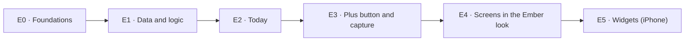

# Forge Ember build plan

> Generated from `docs/plan/plan.json` by `scripts/plan/plan-lint.mjs --render`. Edit the JSON, not this file.

**Decision:** Direction A (Ember) from docs/designs/app-directions.html, chosen 2026-11-15: dark timeline Today, five dailies, one floating plus that opens a typed capture sheet, six labelled tabs kept. Design spec: docs/plan/ember/DESIGN.md.

**6 phases · 34 waves · 83 tasks · widest wave 7 tasks in parallel**

**3 tasks are yours** (marked 👤): `E4-U1`, `E5-U1`, `E5-U2`

## Open decisions (defaults are assumed so nothing blocks)

| # | Decision | Default assumed | Affects |
|---|---|---|---|
| E1 | Which five things count as dailies? | Habits (all checked in), expenses logged, mood logged, code solved (goal 3), daily puzzle. Reminders and tasks do not count. Changeable in Settings. | E1-07, E4-11 |
| E2 | What does a tap on plus open? | The capture sheet on the type that fits the screen (Expense on Money, Reminder on Reminders, Note on Notes, Solve on Logic), otherwise the last type used. All types are one chip away. | E3-04 |
| E3 | What happens to the nine Today tiles? | Tasks, Code, Spend and Mood tiles are replaced by the dailies and timeline. Streak, Wallet, Pets, Watch and Tutor stay below the timeline. | E2-05 |
| E4 | Does Ember replace the current themes? | No. Ember becomes the default for new installs; the seven existing themes stay selectable and your saved theme is kept. | E0-07 |
| E5 | Fonts: load Space Grotesk, Inter and JetBrains Mono, or stay on system fonts? | Self-host the three families (latin subset, under 160 kB) so the app works offline and matches the mockup. | E0-04 |
| E6 | Icons: keep emoji in the tab bar? | Tabs and controls use line icons. Category emoji and pets stay emoji. | E0-05, E0-12 |
| E7 | Which new reminder features are in scope? | Snooze (1 hour, tonight 8 PM, tomorrow 9 AM), repeat (daily, weekly on chosen days, monthly) and one-tap reschedule for overdue items. Real alerts (push) stay in the main plan. | E1-03, E4-02 |
| E8 | Does a day with no spending count as logged? | Yes, if you tap "Nothing spent today". Otherwise a day counts only when it has at least one entry. | E1-02, E4-04 |
| E9 | What counts as the daily puzzle? | Any puzzle from the bank solved today, or the Lichess daily marked solved. | E1-01, E1-09 |
| E10 | Widgets: build them now or after the web app ships? | After. Phase E5 starts only when you confirm a Mac with Xcode, an Apple Developer account and the iPhone shell from the main plan. | E5 |

## E0 · Foundations

Make the wave runner work with this plan, add the Ember theme, fonts, icons and the new primitives, and switch the tab bar to line icons. No screen changes yet.

13 tasks across 4 waves.

**Exit criteria**
- npm test, lint, build, size and e2e green
- Ember is the default theme for a new install; a saved theme is untouched
- gallery.html shows every new primitive under ember and cream
- six labelled tabs with line icons fit at 390px
- tools/live/wave.mjs runs against docs/plan/ember/plan.json

### E0 · Wave 1 — 6 in parallel

| Task | Title | Size | Writes | Depends on | Acceptance |
|---|---|---|---|---|---|
| `E0-01` | Make the wave runner and live graph work with any plan file | M | `tools/live/**` `test/waveRunner.test.js` | — | FORGE_PLAN=docs/plan/ember/plan.json node tools/live/wave.mjs status prints counts for E0..E5; with FORGE_PLAN unset it still reads docs/plan/plan.json; node --test test/waveRunner.test.js passes; grep -c "session_01T1mhHa" tools/live/wave.mjs prints 0 |
| `E0-02` | Record the Ember decision and defaults E1-E10 as an ADR | S | `docs/adr/0005-ember-direction.md` | — | test -f docs/adr/0005-ember-direction.md && grep -c "^\| E" docs/adr/0005-ember-direction.md prints 10; status line says Accepted for the direction and Default assumed for each open decision |
| `E0-03` | Add the Ember theme tokens plus type, spacing and motion scales | M | `src/styles/ember.css` `test/emberTokens.test.js` | — | node --test test/emberTokens.test.js passes: every token in DESIGN.md section 2 is defined under :root[data-accent="ember"]; text, secondary and accent on bg and on surface are >= 4.5:1; accent-fg on accent >= 4.5:1 |
| `E0-04` | Self-host Space Grotesk, Inter and JetBrains Mono (latin subset) | M | `package.json` `package-lock.json` `src/styles/fonts.css` `test/fonts.test.js` | — | npm run build emits woff2 files only for the weights in DESIGN.md section 2; their total size is under 160 kB; fonts.css uses font-display: swap; node --test test/fonts.test.js passes; no request to fonts.googleapis.com anywhere in dist |
| `E0-05` | Add an SVG line-icon set and Icon component | S | `src/ui/Icon.jsx` `src/ui/icons.js` `test/icons.test.js` | — | node --test test/icons.test.js passes: icons.js exports the 20 names listed in DESIGN.md section 3.1, each a 24x24 path string; Icon renders aria-hidden unless a label prop is given |
| `E0-06` | Add the fixed sample day used by the mockups as an e2e fixture | S | `e2e/fixtures/ember-day.js` | — | node -e "import('./e2e/fixtures/ember-day.js').then(m=>{if(!m.NOW\|\|m.reminders.length<5\|\|m.expenses.length<5)process.exit(1)})" exits 0; NOW is Sun 15 Nov 2026 16:18 local |

### E0 · Wave 2 — 4 in parallel

| Task | Title | Size | Writes | Depends on | Acceptance |
|---|---|---|---|---|---|
| `E0-07` | Register Ember as a theme and make it the default for new installs | M | `src/App.jsx` `src/store.js` `src/main.jsx` `index.html` `test/emberTheme.test.js` `vite.config.js` | E0-03, E0-04 | node --test test/emberTheme.test.js passes: THEMES has ember first with chrome #0a0c10; getSettings() with no saved theme returns ember; a saved theme (for example ocean) is returned unchanged; npm run build green; workbox globPatterns in vite.config.js include woff2 so the fonts are precached |
| `E0-08` | Build DailyCell and SegDots primitives | S | `src/ui/DailyCell.jsx` `src/ui/SegDots.jsx` `src/ui/ember-ui.css` `test/segDots.test.js` | E0-03 | node --test test/segDots.test.js passes (filled/empty mapping, aria-label "13 of 15 days logged"); DailyCell has done and open states that differ by more than colour (a check glyph when done) |
| `E0-09` | Build TimelineRow and NextUpCard primitives | M | `src/ui/TimelineRow.jsx` `src/ui/NextUpCard.jsx` `src/ui/timeline.css` | E0-03, E0-05 | npm run build green; TimelineRow supports kinds reminder, note, expense, now and done; touch targets are >= 44px under (pointer: coarse); no colour literal in timeline.css outside var() |
| `E0-10` | Build the Fab primitive and add count badges to SubNav | S | `src/ui/Fab.jsx` `src/ui/fab.css` `src/ui/SubNav.jsx` `src/ui/subnav.css` | E0-03, E0-05 | npm run build green; Fab is a 56px button with aria-label, sits above var(--tabbar-h) plus the bottom safe area; SubNav items accept an optional count and existing SubNav callers render unchanged |

### E0 · Wave 3 — 2 in parallel

| Task | Title | Size | Writes | Depends on | Acceptance |
|---|---|---|---|---|---|
| `E0-11` | Show the new primitives in the component gallery | S | `src/ui/Gallery.jsx` | E0-08, E0-09, E0-10 | npm run build green; gallery.html shows DailyCell (done, open), SegDots, TimelineRow (5 kinds), NextUpCard, Fab and Icon grid under the ember theme and under cream |
| `E0-12` | Switch the six tab icons from emoji to line icons | S | `src/shell/Nav.jsx` `src/styles/nav.css` `test/navIcons.test.js` | E0-05, E0-07 | node --test test/navIcons.test.js passes (six items, order today, life, logic, money, invest, agents, each with an Icon name); npx playwright test e2e/matrix/phone.spec.js --trace off passes with six labelled tabs at 390px |

### E0 · Wave 4 — 1 in parallel

| Task | Title | Size | Writes | Depends on | Acceptance |
|---|---|---|---|---|---|
| `E0-GATE` | Phase gate: foundations | S | `docs/plan/ember/reports/E0-gate.md` | E0-01, E0-02, E0-06, E0-11, E0-12 | npm test, npm run lint, npm run build, npm run size and npm run test:e2e -- --trace off all green; report lists each exit criterion with pass or fail and a screenshot of gallery.html under ember; stop for owner sign-off |

## E1 · Data and logic

Add everything the new screens need to know, as tested pure logic: the five dailies, puzzle solve dates, expense logging days, the Today timeline, reminder snooze and repeat, and the capture parser.

17 tasks across 5 waves.

**Exit criteria**
- npm test, lint and build green
- the fixture day computes 3 of 5 dailies
- old backups and old puzzle progress still load
- sync v2 flags remain off and no SQL was touched

### E1 · Wave 1 — 6 in parallel

| Task | Title | Size | Writes | Depends on | Acceptance |
|---|---|---|---|---|---|
| `E1-01` | Record the day a puzzle was solved | S | `src/logic/puzzleProgress.js` `test/puzzleProgress.test.js` | E0-GATE | node --test test/puzzleProgress.test.js passes: normalize(true) gives {solved:true, at:null}; markSolved(id, now) stores at; solvedOn(progress, dayKey) counts only dated solves; old boolean data round-trips without loss |
| `E1-02` | Work out which days expenses were logged, and the logging run | S | `src/money/dayLog.js` `test/moneyDayLog.test.js` | E0-GATE | node --test test/moneyDayLog.test.js passes: loggedDays counts a day with any transaction or a no-spend mark; logStreak ends at today or yesterday; monthStrip(now) returns one boolean per day up to today; local-midnight edges covered |
| `E1-03` | Add snooze, repeat and reschedule rules for reminders | M | `src/life/reminderLogic.js` `test/reminderLogic.test.js` | E0-GATE | node --test test/reminderLogic.test.js passes: snooze presets (1 hour, tonight 8 PM, tomorrow 9 AM); repeat none, daily, weekly on chosen weekdays, monthly; completing a repeating reminder returns the next occurrence; month-end and DST cases covered |
| `E1-04` | Write the capture parser: one sentence to a typed draft | M | `src/capture/parse.js` `test/captureParse.test.js` | E0-GATE | node --test test/captureParse.test.js passes at least 30 cases, including "450 coffee with raj" -> expense 450 coffee person Raj today; "call mom tomorrow 6pm" -> reminder; "gym tomorrow 5pm" with type task -> task; "solved cf 1328E" -> solve; plain text -> note; each result lists the tokens it used |
| `E1-05` | Derive a note title and excerpt from its first line | S | `src/life/noteTitle.js` `test/noteTitle.test.js` | E0-GATE | node --test test/noteTitle.test.js passes: title is the first non-empty line trimmed to 80 chars, excerpt is the rest collapsed to one line; a one-line note has an empty excerpt |
| `E1-06` | Add the dailyLog synced key (no-spend days, daily puzzle done) | M | `src/store.js` `src/sync/flags.js` `src/sync/appSubscriptions.js` `src/backup/backup.js` `test/dailyLogStore.test.js` `test/backup.test.js` `test/appSubscriptions.test.js` `test/syncAdapters.test.js` `test/syncRouter.test.js` | E0-GATE | node --test test/dailyLogStore.test.js test/backup.test.js test/sync.test.js test/appSubscriptions.test.js passes: dailyLog is in SYNCED_KEYS and the flags list, exports and imports in a backup, and a backup made before this change still imports |

### E1 · Wave 2 — 7 in parallel

| Task | Title | Size | Writes | Depends on | Acceptance |
|---|---|---|---|---|---|
| `E1-07` | Compute the five dailies from stored data | M | `src/today/dailies.js` `test/dailies.test.js` | E1-01, E1-02, E1-06 | node --test test/dailies.test.js passes: returns habits, spend, mood, code, puzzle in that order, each with label, value text, done flag and href; with the fixture day it gives 3 of 5 done; zero habits means the habits daily is not counted |
| `E1-08` | Build the Today timeline and pick the next-up item | M | `src/today/timeline.js` `test/timeline.test.js` | E1-03, E1-05 | node --test test/timeline.test.js passes: merges today's reminders, timed tasks, expenses and notes in time order with one now marker; nextUp is the earliest open reminder or timed task after now; overdue items are returned separately, oldest first |
| `E1-09` | Make the Puzzles screen store solve dates and the Lichess daily mark | M | `src/tabs/Puzzles.jsx` `src/tabs/LogicBuilding.jsx` | E1-01, E1-06 | npm test and npm run build green; marking a bank puzzle solved writes a dated entry; the Lichess card has a Mark solved control that sets dailyLog[today].puzzle; the Puzzles solved count still reads 0..145 with old boolean data |
| `E1-10` | Add reminder actions: snooze, reschedule, repeat, complete | M | `src/life/LifeData.jsx` `test/lifeReminderActions.test.js` | E1-03 | node --test test/lifeReminderActions.test.js test/lifeRecords.test.js passes: each action stamps updatedAt, completing a repeating reminder creates the next one exactly once, and every action is undoable through the existing undo helper |
| `E1-11` | Expose logged days and a no-spend action from MoneyContext | S | `src/money/MoneyContext.jsx` `test/moneyNoSpend.test.js` `src/store.js` `test/syncRouter.test.js` | E1-02, E1-06 | node --test test/moneyNoSpend.test.js passes: markNoSpend(dayKey) sets dailyLog[day].noSpend, adding a transaction that day clears it, and the context value includes logStreak and monthStrip |
| `E1-13` | Include reminders in command palette search | S | `src/shell/searchIndex.js` `test/searchIndex.test.js` | E0-GATE | node --test test/searchIndex.test.js passes with a new case: an open reminder is found by title and navigates to #/life/reminders |
| `E1-15` | Fix cream theme: visible done glyph and SegDots empty contrast | S | `src/ui/ember-ui.css` `test/emberUiCream.test.js` | E0-GATE | node --test test/emberUiCream.test.js passes: ember-ui.css never uses --success-fg or other ember-only tokens without a fallback that exists under cream; empty SegDots border/fill has >= 3:1 contrast on the cream background; screenshot of gallery under cream shows the done check |

### E1 · Wave 3 — 2 in parallel

| Task | Title | Size | Writes | Depends on | Acceptance |
|---|---|---|---|---|---|
| `E1-12` | Add the useDailies hook that feeds Today | M | `src/today/useDailies.js` `test/useDailiesLoad.test.js` | E1-07, E1-08, E1-10, E1-11 | node --test test/useDailiesLoad.test.js passes for the pure loader (keys read, result shape); the hook re-computes on store events for the keys it reads and exposes actions completeReminder, snooze, reschedule, checkIn, logMood, markNoSpend |
| `E1-16` | Pass reminders to the command palette search index | S | `src/shell/CommandPalette.jsx` `test/commandPaletteReminders.test.js` | E1-13 | node --test test/commandPaletteReminders.test.js passes: CommandPalette passes the reminders list into buildIndex (static source check or bundled render); npm test and build green |

### E1 · Wave 4 — 1 in parallel

| Task | Title | Size | Writes | Depends on | Acceptance |
|---|---|---|---|---|---|
| `E1-17` | Mount the Life data provider at the app shell so the palette sees reminders and tasks | S | `src/App.jsx` `test/appPaletteData.test.js` | E1-16 | node --test test/appPaletteData.test.js passes: App renders CommandPalette inside a LifeDataProvider (source check or bundled render); the Life screens still work (npm test, npm run build green, e2e smoke green) |

### E1 · Wave 5 — 1 in parallel

| Task | Title | Size | Writes | Depends on | Acceptance |
|---|---|---|---|---|---|
| `E1-GATE` | Phase gate: data and logic | S | `docs/plan/ember/reports/E1-gate.md` | E1-04, E1-09, E1-12, E1-13, E1-15, E1-16, E1-17 | npm test, npm run lint and npm run build green; report gives the new test count, confirms a pre-change backup file imports, and confirms sync v2 flags are still all off; stop for owner sign-off |

## E2 · Today

Replace the top of Today with the Ember layout: header with ring, five dailies, next up, and the timeline, keeping five of the existing tiles below.

11 tasks across 5 waves.

**Exit criteria**
- Today matches the mockup at 390px (differences listed in the gate report)
- checking the next-up reminder advances it
- no horizontal scroll at 390, 834, 1194, 1440
- owner sign-off

### E2 · Wave 1 — 5 in parallel

| Task | Title | Size | Writes | Depends on | Acceptance |
|---|---|---|---|---|---|
| `E2-01` | Build the dailies strip | S | `src/today/DailiesStrip.jsx` `src/today/dailies.css` | E1-GATE | npm run build green; five cells in one row at 390px with no wrap; each is a link to its screen; done cells show the done style and a check; loading state shows five skeleton cells |
| `E2-02` | Build the next-up card with Done, Snooze and the overdue chip | M | `src/today/NextUp.jsx` `src/today/nextup.css` | E1-GATE | npm run build green; shows title, time and "in N min"; Done and Snooze 1h call the passed handlers; an overdue chip above it shows the count and oldest title and offers Today 7 PM; empty state reads "Nothing left on the clock." |
| `E2-03` | Build the Today timeline list | M | `src/today/Timeline.jsx` `src/today/timeline-screen.css` | E1-GATE | npm run build green; renders rows from timeline.js with times in the device 12h or 24h format; reminders have a working check; expense rows show the amount right-aligned in tabular figures; the now row is announced as "Now" to screen readers |
| `E2-04` | Build the Today header: date, streak and the dailies ring | S | `src/today/TodayHeader.jsx` `src/today/today-header.css` | E1-GATE | npm run build green; shows "SUN 15 NOV · 12-DAY STREAK" style line, the title Today and a ring with done/total and an aria-label such as "3 of 5 dailies done"; with no streak the streak part is omitted |
| `E2-09` | Bring the entry JS bundle back under the 135 kB budget by lazy-loading | M | `src/App.jsx` `vite.config.js` `test/entryChunk.test.js` `test/appPaletteData.test.js` | E1-GATE | npm run build then npm run size reports entry JS <= 135 kB with scripts/ci/budgets.json UNCHANGED; npm test, npm run test:e2e -- --trace off green; test/entryChunk.test.js asserts the built entry chunk does not contain the reminder-action and capture-parser modules (they load lazily) |

### E2 · Wave 2 — 1 in parallel

| Task | Title | Size | Writes | Depends on | Acceptance |
|---|---|---|---|---|---|
| `E2-05` | Compose the new Today home | M | `src/today/TodayHome.jsx` `src/today/today.css` | E2-01, E2-02, E2-03, E2-04 | npm test and npm run build green; order is header, dailies, next up, timeline, then the kept tiles (Streak, Wallet, Pets, Watch, Tutor); Tasks, Code, Spend and Mood tiles are no longer mounted; from 900px container width the kept tiles sit in a second column; the error state still renders |

### E2 · Wave 3 — 2 in parallel

| Task | Title | Size | Writes | Depends on | Acceptance |
|---|---|---|---|---|---|
| `E2-06` | Add end-to-end checks for Today | M | `e2e/today-ember.spec.js` `e2e/matrix/phone.spec.js` `e2e/matrix/ipad-portrait.spec.js` `e2e/matrix/ipad-landscape.spec.js` `e2e/matrix/desktop.spec.js` | E2-05 | npx playwright test e2e/today-ember.spec.js e2e/matrix --trace off passes: with the fixture day the ring reads 3/5, next up is Gym, checking Gym moves next up to Call mom, and there is no horizontal scroll at 390, 834, 1194 and 1440 |
| `E2-07` | Celebrate once when all dailies are done | S | `src/today/celebrate.js` `src/today/TodayHome.jsx` `test/todayCelebrate.test.js` | E2-05 | node --test test/todayCelebrate.test.js passes: fires once per local day when done reaches total, never on load when already complete, and not at all under prefers-reduced-motion |

### E2 · Wave 4 — 2 in parallel

| Task | Title | Size | Writes | Depends on | Acceptance |
|---|---|---|---|---|---|
| `E2-10` | Fix the Today second column from 900px (container query on its own container) | S | `src/today/today.css` | E2-06 | npx playwright test e2e/today-ember.spec.js e2e/matrix/ipad-landscape.spec.js e2e/matrix/desktop.spec.js --trace off: the second-column and section-order tests pass; npm test and build green |
| `E2-11` | Timeline note rows use the note body for the title | S | `src/today/timeline.js` `test/timeline.test.js` | E2-06 | node --test test/timeline.test.js passes with a new case: a note stored as {body} gets the first line of body as title; text field still works as fallback; header comment in timeline.js documents body; the e2e test timeline lists today in time order passes |

### E2 · Wave 5 — 1 in parallel

| Task | Title | Size | Writes | Depends on | Acceptance |
|---|---|---|---|---|---|
| `E2-GATE` | Phase gate: Today | S | `docs/plan/ember/reports/E2-gate.md` | E2-06, E2-07, E2-10, E2-11 | npm test, npm run lint, npm run build, npm run size and npm run test:e2e -- --trace off green; report has Today screenshots at 390, 834 and 1194 next to the mockup and lists every visible difference; stop for owner sign-off |

## E3 · Plus button and capture

One plus button on every tab that opens a capture sheet: type a sentence, check the chips, save. Covers expense, income, note, reminder, task, habit check-in, solve and mood.

15 tasks across 8 waves.

**Exit criteria**
- an expense can be logged from any tab without visiting Money
- N and the command palette open capture
- every save can be undone
- the Money-only add button is gone
- owner sign-off

### E3 · Wave 1 — 5 in parallel

| Task | Title | Size | Writes | Depends on | Acceptance |
|---|---|---|---|---|---|
| `E3-01` | Build the capture sheet frame: type chips, text field, parsed chips | M | `src/capture/CaptureSheet.jsx` `src/capture/capture.css` | E2-GATE | npm run build green; chips Expense, Note, Reminder, Task, Habit, Solve, Mood scroll sideways at 390px; typing shows parsed chips live; the primary button label names the type ("Add expense"); focus starts in the field and Esc closes |
| `E3-02` | Map a parsed draft to store changes for every type | M | `src/capture/submit.js` `test/captureSubmit.test.js` | E2-GATE | node --test test/captureSubmit.test.js passes: expense, income, note, reminder, task, habit check-in, solve and mood each produce the same record shape the existing screens create; an expense with no category is rejected with the message "Pick a category"; every submit returns an undo function |
| `E3-03` | Build the chip editors: amount, category, when, repeat, person | M | `src/capture/editors/**` | E2-GATE | npm run build green; CategoryPicker shows the 12 categories sorted by recent use; WhenPicker offers Tonight 8 PM, Tomorrow 9 AM, Sat 10 AM and Pick a time; every control is reachable by keyboard and is >= 44px on touch |
| `E3-04` | Add capture state: open, prefill, and the default type per screen | S | `src/capture/captureContext.js` `test/captureDefaults.test.js` | E2-GATE | node --test test/captureDefaults.test.js passes: default type is expense on money, reminder on life/reminders, note on life/notes, task on life/tasks, solve on logic, otherwise the last used type (stored locally), falling back to expense |
| `E3-09` | Build the non-text panels: habit check-in, mood, solve | M | `src/capture/panels/**` | E2-GATE | npm run build green; Habit lists habits not yet checked in today with one-tap check-in; Mood shows the five existing moods; Solve offers "Solved a problem" (adds to code today) and "Daily puzzle done"; each panel shows a clear empty state |

### E3 · Wave 2 — 2 in parallel

| Task | Title | Size | Writes | Depends on | Acceptance |
|---|---|---|---|---|---|
| `E3-05` | Wire the capture sheet: editors, panels, submit, undo toast | M | `src/capture/CaptureSheet.jsx` `test/captureFlow.test.js` `test/capturePanels.test.js` `src/capture/panels/panels.test.js` `test/captureEditors.test.js` `src/capture/editors/editors.test.js` | E3-01, E3-02, E3-03, E3-04, E3-09 | node --test test/captureFlow.test.js passes for the pure reducer; saving closes the sheet, shows a toast with Undo, and Undo restores the previous data; a failed save keeps the sheet open with the typed text intact |
| `E3-06` | Put the plus button in the shell on every tab | S | `src/shell/Shell.jsx` `src/styles/shell.css` `src/shell/TopBar.jsx` `test/shellCss.test.js` | E3-04 | node --test test/shellCss.test.js passes; the Fab is bottom-right above the tab bar below 600px, bottom-right of the page from 600px, and never covers the last list row (the page gets matching bottom padding); it is hidden while a sheet is open |

### E3 · Wave 3 — 2 in parallel

| Task | Title | Size | Writes | Depends on | Acceptance |
|---|---|---|---|---|---|
| `E3-08` | Replace the Money-only add button with the global plus | S | `src/money/MoneyApp.jsx` `src/money/money.css` `src/today/DailiesStrip.jsx` | E3-05 | npm test and npm run build green; the money-fab is gone; + Expense and + Income on Spend open capture prefilled with that type; the Mood dailies cell opens capture on Mood; editing an existing transaction still uses the existing edit sheet |
| `E3-11` | Move the capture sheet inline styles into capture.css and style the editor and panel hosts | S | `src/capture/CaptureSheet.jsx` `src/capture/capture.css` `test/captureStyles.test.js` | E3-05 | node --test test/captureStyles.test.js passes: CaptureSheet.jsx has no style={{ props left for colour or layout, capture.css defines .capture-chip, .capture-editor and .capture-panel-host with tokens only and a cream-safe fallback; test/captureFlow.test.js still passes unchanged |

### E3 · Wave 4 — 1 in parallel

| Task | Title | Size | Writes | Depends on | Acceptance |
|---|---|---|---|---|---|
| `E3-07` | Mount capture in the app, add the N shortcut and palette commands | M | `src/App.jsx` `src/shell/commands.js` `src/shell/useShortcuts.js` `test/commands.test.js` `src/money/MoneyContext.jsx` `src/money/MoneyApp.jsx` `src/store.js` `test/syncRouter.test.js` `src/capture/CaptureSheet.jsx` | E3-05, E3-06, E3-08, E3-11 | node --test test/commands.test.js passes: N opens capture with the screen default; the palette lists New expense, New note, New reminder, New task, Check in a habit, Log mood; N does nothing while typing in an input |

### E3 · Wave 5 — 1 in parallel

| Task | Title | Size | Writes | Depends on | Acceptance |
|---|---|---|---|---|---|
| `E3-10` | Add end-to-end checks for capture | M | `e2e/capture.spec.js` | E3-07, E3-08 | npx playwright test e2e/capture.spec.js --trace off passes: plus, type "450 coffee with raj", Add expense -> row appears under Today in Money and the spend daily is done; "call mom tomorrow 6pm" creates a reminder; Undo removes it; focus returns to the plus button on close |

### E3 · Wave 6 — 2 in parallel

| Task | Title | Size | Writes | Depends on | Acceptance |
|---|---|---|---|---|---|
| `E3-12` | Return focus to the plus button when the capture sheet closes | S | `src/shell/Shell.jsx` `test/shellFocus.test.js` `test/shellCss.test.js` | E3-10 | npx playwright test e2e/capture.spec.js --trace off: the test Esc closes and focus returns to the plus button passes in every project; node --test test/shellFocus.test.js passes (Shell keeps the Fab mounted while the sheet is open); npm test and build green |
| `E3-13` | Make Life follow the sub-view in the route (reminders, notes) | S | `src/App.jsx` `test/lifeRoute.test.js` | E3-10 | npx playwright test e2e/capture.spec.js --trace off: the deep link #/life/reminders renders the Reminders view; tapping the Reminders or Notes pill changes the hash; the plus then opens on Reminder or Note; node --test test/lifeRoute.test.js passes; npm test and build green |

### E3 · Wave 7 — 1 in parallel

| Task | Title | Size | Writes | Depends on | Acceptance |
|---|---|---|---|---|---|
| `E3-14` | Point the phone matrix FAB-offset check at the global plus button | S | `e2e/matrix/phone.spec.js` | E3-12 | npx playwright test e2e/matrix/phone.spec.js --trace off passes in every project: the test tab bar height and FAB offset follow the --tabbar-h arithmetic finds the button named New entry and keeps both geometric assertions (bottom gap equals max(--tabbar-h, inset) + 12, and it clears the tab bar) unchanged |

### E3 · Wave 8 — 1 in parallel

| Task | Title | Size | Writes | Depends on | Acceptance |
|---|---|---|---|---|---|
| `E3-GATE` | Phase gate: plus button and capture | S | `docs/plan/ember/reports/E3-gate.md` | E3-10, E3-11, E3-12, E3-13, E3-14 | npm test, npm run lint, npm run build, npm run size and npm run test:e2e -- --trace off green; report states the tap count to log an expense on a phone and attaches capture screenshots at 390 and 1194; stop for owner sign-off |

## E4 · Screens in the Ember look

Bring Life, Money, Logic, Invest, Agents and Settings to the Ember design, including reminders with snooze and repeat, notes with titles, and the expense logging strip.

16 tasks across 5 waves.

**Exit criteria**
- all sub-views pass the device matrix
- text contrast >= 4.5:1 on the ember theme
- owner device checklist complete
- the web app is shippable

### E4 · Wave 1 — 6 in parallel

| Task | Title | Size | Writes | Depends on | Acceptance |
|---|---|---|---|---|---|
| `E4-01` | Restyle the Life frame: header line and section chips with counts | S | `src/tabs/Life.jsx` `src/life/life.css` | E3-GATE | npm test and npm run build green; chips read Tasks N, Reminders N, Notes N, Habits, Growth and keep their routes; the header shows wallet and level in the mono style; no horizontal scroll at 390px |
| `E4-02` | Rebuild Reminders: sections, week strip, reschedule, snooze, repeat | M | `src/life/screens/Reminders.jsx` `src/life/screens/ReminderInspector.jsx` `src/life/reminders.css` | E3-GATE | npm test and npm run build green; sections Overdue, Today, Tomorrow, Later, Done; an overdue row offers Today 7 PM; the inspector edits title, time and repeat and offers the three snooze presets; Add to Calendar and Undo on delete still work |
| `E4-03` | Rebuild Notes: title and excerpt rows, Pinned and Recent, tag chips | M | `src/life/screens/Notes.jsx` `src/life/screens/NoteInspector.jsx` `src/life/notes.css` | E3-GATE | npm test and npm run build green; rows show colour dot, title, two-line excerpt, tags, sub-note count and date; tag chips filter in one tap; nesting, pin, colour, drag and drop, cascade delete and Undo behave as before (existing notesTree tests pass) |
| `E4-04` | Rebuild Money Spend: month card, logging strip, day groups | M | `src/money/screens/SpendScreen.jsx` `src/money/screens/SpendSummary.jsx` `src/money/screens/TxnList.jsx` `src/money/screens/spend.css` | E3-GATE | npm test and npm run build green; the top card shows month spend, budget, a bar and "left"; under it "Logged N days in a row" with one square per day of the month so far; a "Nothing spent today" button appears only when today has no entries; category bars and the 3-month trend remain below the day list |
| `E4-05` | Restyle Logic: solved-today ring, daily puzzle status, code streak | M | `src/tabs/LogicBuilding.jsx` `src/tabs/Puzzles.jsx` `src/logic/logic.css` `src/logic/puzzles.css` | E3-GATE | npm test and npm run build green; the header shows Solved today n/goal as a ring, "Daily puzzle: open" or "solved", and the code streak; section chips Code, Puzzles, Exams, DSA keep their routes |
| `E4-06` | Restyle Tasks, Habits and Growth | M | `src/life/screens/Tasks.jsx` `src/life/screens/TaskInspector.jsx` `src/life/screens/Habits.jsx` `src/life/screens/HabitInspector.jsx` `src/life/screens/Growth.jsx` `src/life/screens/GrowthInspector.jsx` `src/life/wellbeing.css` | E3-GATE | npm test and npm run build green; task sections and quadrant chips use the ember row style; the habit card keeps pet, streak, health, earnings and Check in; the task inspector gains a time-of-day field for dueAt; drag and drop still works |

### E4 · Wave 2 — 6 in parallel

| Task | Title | Size | Writes | Depends on | Acceptance |
|---|---|---|---|---|---|
| `E4-07` | Restyle Budgets, Goals and Loans | M | `src/money/screens/BudgetsScreen.jsx` `src/money/screens/GoalsScreen.jsx` `src/money/screens/GoalFormSheet.jsx` `src/money/screens/LoansScreen.jsx` `src/money/screens/LoanFormSheet.jsx` `src/money/screens/LoanPersonCard.jsx` `src/money/money.css` `src/money/AddTxnSheet.jsx` | E4-04 | npm test and npm run build green; all four Money sections share the chip row and card style; budget warnings at 80% and 100% keep their text; no behaviour change (moneyLogic and loanBalance tests pass) |
| `E4-08` | Restyle Invest: Learn, Research, Watchlist | S | `src/invest/screens/**` `src/invest/invest.css` | E3-GATE | npm test and npm run build green; the disclaimer bar stays visible; watchlist rows use tabular figures and the ember row style; no behaviour change (investLogic tests pass) |
| `E4-09` | Restyle Agents | S | `src/tabs/Agents.jsx` `src/agents/agents.css` | E3-GATE | npm test and npm run build green; topic chips and the More tools menu use the chip style; chat bubbles use surface tokens; streaming, Stop and Retry behave as before (agentStreamClient tests pass) |
| `E4-10` | Restyle Code, Exams and the DSA frame | M | `src/tabs/CodeView.jsx` `src/tabs/Exams.jsx` `src/tabs/DsaView.jsx` `src/logic/code.css` `src/logic/exams.css` `src/logic/dsa.css` | E4-05 | npm test and npm run build green; problem rows show rating and tags in the mono style; exam percentages never exceed 100; keyboard j, k, x, s still work in Code |
| `E4-11` | Move Settings to its own panel and add the dailies settings | M | `src/App.jsx` `src/settings/SettingsPanel.jsx` `src/settings/settings.css` `src/today/dailies.js` `test/dailies.test.js` | E3-GATE | node --test test/dailies.test.js passes with new cases: settings.dailyCodeGoal (1 to 10, default 3) and settings.dailies (which of the five count) change the result; the panel has Codeforces handle, Theme, Daily code goal, Dailies and Backup |
| `E4-12` | Replace hard-coded colours in the legacy stylesheet with tokens | M | `src/styles.css` `test/legacyColours.test.js` | E3-GATE | node --test test/legacyColours.test.js passes: no hex or rgb literal remains in src/styles.css outside the token blocks at the top; npm run build green; the cream and sky themes still render (existing e2e smoke passes) |

### E4 · Wave 3 — 2 in parallel

| Task | Title | Size | Writes | Depends on | Acceptance |
|---|---|---|---|---|---|
| `E4-13` | Extend the device matrix to every sub-view and add a contrast check | M | `e2e/ember-screens.spec.js` `e2e/helpers/contrast.js` `e2e/matrix/phone.spec.js` `e2e/matrix/ipad-portrait.spec.js` `e2e/matrix/ipad-landscape.spec.js` `e2e/matrix/desktop.spec.js` | E4-01, E4-02, E4-03, E4-06, E4-07, E4-08, E4-09, E4-10, E4-11, E4-12 | npm run test:e2e -- --trace off passes: all 17 sub-views plus Today and Agents load at 390, 834, 1194 and 1440 with no horizontal scroll and no console errors; visible text on the ember theme meets 4.5:1 on Today, Reminders, Notes and Spend |
| `E4-14` | Update the README and write the device checklist | S | `README.md` `docs/qa/ember-device-checklist.md` | E4-01, E4-04, E4-05 | test -f docs/qa/ember-device-checklist.md && grep -c "^- \[ \]" docs/qa/ember-device-checklist.md prints >= 25; README Layout section names src/capture, src/today/dailies.js and the ember theme |

### E4 · Wave 4 — 1 in parallel

| Task | Title | Size | Writes | Depends on | Acceptance |
|---|---|---|---|---|---|
| `E4-U1` 👤 | Owner: run the device checklist on your iPhone and iPad | S | `docs/plan/ember/reports/E4-device-check.md` | E4-13, E4-14 | docs/plan/ember/reports/E4-device-check.md exists with every item in docs/qa/ember-device-checklist.md marked pass or fail, the device and iOS version, and a note for each fail |

### E4 · Wave 5 — 1 in parallel

| Task | Title | Size | Writes | Depends on | Acceptance |
|---|---|---|---|---|---|
| `E4-GATE` | Phase gate: screens | S | `docs/plan/ember/reports/E4-gate.md` | E4-U1 | npm test, npm run lint, npm run build, npm run size, npm run check:secrets and npm run test:e2e -- --trace off green; every fail in the device check is fixed or listed as accepted by the owner; stop for owner sign-off. The web app is shippable at this point |

## E5 · Widgets (iPhone)

Small, medium, large and lock-screen widgets fed by a snapshot from the app, with tick-off from the widget. Needs the iPhone app shell, a Mac and an Apple Developer account.

11 tasks across 7 waves.

**Exit criteria**
- widgets show current data after a change in the app
- ticking a reminder in a widget is reflected in the app
- owner used them on a real phone for two days

### E5 · Wave 1 — 3 in parallel

| Task | Title | Size | Writes | Depends on | Acceptance |
|---|---|---|---|---|---|
| `E5-U1` 👤 | Owner: confirm the iPhone app prerequisites | S | `docs/plan/ember/reports/E5-prereqs.md` | E4-GATE | The report states: Mac model and Xcode version (26 or later), Apple Developer team id, bundle id, iPhone model and iOS version, and that the Capacitor shell from docs/plan/plan.json phase P4 (tasks X1-11, X1-12, X1-13) builds and runs on the device |
| `E5-01` | Build the widget snapshot from app data | M | `src/widgets/snapshot.js` `test/widgetSnapshot.test.js` | E4-GATE | node --test test/widgetSnapshot.test.js passes: output has schema version, day key, five dailies, done count, streak, nextUp, up to 4 open reminders, overdue count, spend today, month spend and budget; it is under 4 kB as JSON; it contains no note bodies beyond one pinned title |
| `E5-02` | Write the widget spec: sizes, content, links, actions | S | `docs/plan/ember/WIDGETS.md` | E4-GATE | test -f docs/plan/ember/WIDGETS.md; it has one section each for small, medium, large, lock rectangle, lock circle and lock inline with content, tap target and link; it defines the snapshot fields each uses, the tinted and clear rendering rule, and the two actions (complete reminder, open capture) |

### E5 · Wave 2 — 2 in parallel

| Task | Title | Size | Writes | Depends on | Acceptance |
|---|---|---|---|---|---|
| `E5-03` | Publish the snapshot to the native side when data changes | S | `src/platform/widgetBridge.js` `test/widgetBridge.test.js` | E5-01 | node --test test/widgetBridge.test.js passes: on the web the bridge is a no-op; with a fake plugin it sends at most one snapshot per 2 seconds, only when the snapshot changed, and once on app resume |
| `E5-04` | Open items and capture from links | S | `src/capture/deepLink.js` `src/capture/captureContext.js` `test/captureDeepLink.test.js` | E5-02 | node --test test/captureDeepLink.test.js passes: #/today?capture=expense opens capture on Expense once and then clears the query; #/life/reminders?id=<id> selects that reminder; unknown values are ignored |

### E5 · Wave 3 — 1 in parallel

| Task | Title | Size | Writes | Depends on | Acceptance |
|---|---|---|---|---|---|
| `E5-05` | Add the native plugin, App Group and widget target | M | `ios/App/App/Plugins/ForgeWidgets/**` `ios/App/App/App.entitlements` `ios/App/App.xcodeproj/project.pbxproj` `ios/App/ForgeWidgets/ForgeWidgetsBundle.swift` `ios/App/ForgeWidgets/Shared/**` `ios/App/ForgeWidgets/Info.plist` `ios/App/ForgeWidgets/ForgeWidgets.entitlements` | E5-U1, E5-03 | xcodebuild -workspace ios/App/App.xcworkspace -scheme App -sdk iphonesimulator build succeeds; calling setSnapshot from the web layer writes the JSON to the App Group container and reloads widget timelines; the widget target uses a folder-synchronised group so later tasks add files without editing project.pbxproj |

### E5 · Wave 4 — 2 in parallel

| Task | Title | Size | Writes | Depends on | Acceptance |
|---|---|---|---|---|---|
| `E5-06` | Build the small, medium and large widgets | M | `ios/App/ForgeWidgets/Home/**` | E5-05 | The simulator build succeeds; SwiftUI previews exist for each size with the fixture snapshot, an empty snapshot and the tinted rendering mode; layouts match WIDGETS.md; all tap targets carry the links from the spec |
| `E5-07` | Build the lock-screen widgets | S | `ios/App/ForgeWidgets/Lock/**` | E5-05 | The simulator build succeeds; previews exist for rectangle (next up), circle (done/total) and inline (spend today and code) with fixture and empty snapshots |

### E5 · Wave 5 — 1 in parallel

| Task | Title | Size | Writes | Depends on | Acceptance |
|---|---|---|---|---|---|
| `E5-08` | Complete a reminder from a widget and reconcile in the app | M | `ios/App/ForgeWidgets/Intents/**` `src/platform/widgetInbox.js` `test/widgetInbox.test.js` | E5-06 | node --test test/widgetInbox.test.js passes: pending actions are applied once through the reminder actions on resume, duplicates and unknown ids are ignored, and the inbox is cleared only after a successful save; on the simulator, ticking a reminder in the medium widget strikes it through and the app shows it done on next open |

### E5 · Wave 6 — 1 in parallel

| Task | Title | Size | Writes | Depends on | Acceptance |
|---|---|---|---|---|---|
| `E5-U2` 👤 | Owner: use the widgets on your phone for two days | S | `docs/plan/ember/reports/E5-device-check.md` | E5-07, E5-08, E5-04 | The report says for each widget: shows correct data within a minute of a change in the app (yes or no), tick-off works (yes or no), links open the right place (yes or no), readable in tinted mode (yes or no), with the device and iOS version |

### E5 · Wave 7 — 1 in parallel

| Task | Title | Size | Writes | Depends on | Acceptance |
|---|---|---|---|---|---|
| `E5-GATE` | Phase gate: widgets | S | `docs/plan/ember/reports/E5-gate.md` | E5-U2 | npm test and npm run build green; the simulator build succeeds; every "no" in the device check is fixed or accepted by the owner; stop for owner sign-off |

